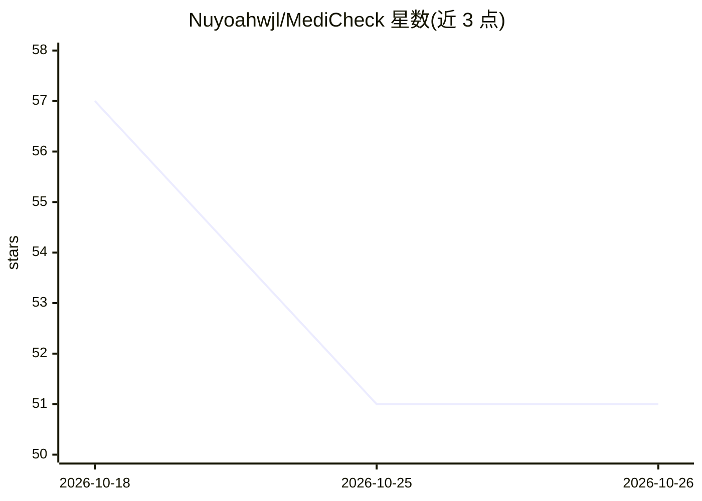

# Nuyoahwjl/MediCheck

⭐ 51 · Python · 推送 2026-05-26 · [GitHub](https://github.com/Nuyoahwjl/MediCheck) · [官网](https://medicheck01.streamlit.app) · 个人维护

**面向用户的多 Agent RAG 体检套餐推荐系统**

基于 AgentOS 框架、调用 DeepSeek V3 API 的个性化体检套餐推荐系统：采用 BM25+稠密向量混合检索与 RRF 融合、BAAI/bge-reranker-v2-m3 重排序、医学同义词扩展（30+ 同义词组）与查询分解；4 个专职 Agent 由 Orchestrator 协调并带反思循环。向量库为 ChromaDB，嵌入用 bge-base-zh，Streamlit 提供 Recommend/Chatbot/Hospitals/Report 四页 UI。含检索/推荐/安全三类指标评测与消融实验框架，PDF 报告生成。运行需配置 DeepSeek API key，先构建向量库再启动 Web 应用。

## 筛选速览

| 维度 | 判定 | 备注 |
|---|---|---|
| AI 角色 | `ai-native` | 本体是模型或模型工具 |
| 许可风险 | `none` | — |
| 部署形态 | `None` |  |
| 模型依赖 | locked-api |  |
| 硬件要求 | — | 无带数字的原话,不猜 |
| 安装摩擦 | `low` | 无编译、无系统依赖或容器化 |
| 成熟度 | — | 结构信号不足 |

## 能力要点

- BM25+稠密向量混合检索，RRF 融合与 bge-reranker-v2-m3 重排序
- 4 个专职 Agent 由 Orchestrator 协调，带反思循环，可切换单 Agent 模式
- 医学同义词扩展（30+ 同义词组）与查询自动分解
- 检索/推荐/安全三组评测指标与消融实验框架

## 适用场景

- 根据个人症状、病史与风险因素获取体检套餐推荐
- 通过对话界面咨询体检项目并生成 PDF 报告
- 按所在地查找医院信息
- 对 RAG 检索与推荐配置做消融实验评估

## 场景标签

`多智能体` `RAG` `聊天机器人` `推荐系统` · 领域:Agent 开发

## 证据(README 行号)

> L5: A multi-agent RAG system for personalized health check package recommendation, built on the AgentOS framework and po
> L16: - **Streamlit Web UI**: 4 pages — Recommend, Chatbot, Hospitals, Report

## 星数曲线

2026-10-18 57 → 2026-10-26 51（-6）

---
*卡片 v1 · prompt 1.4 · 生成 2026-10-25 · 置信度 high · 依据 README sha `4e329ca93d48` · [字段定义](../../DATASET.md)*
