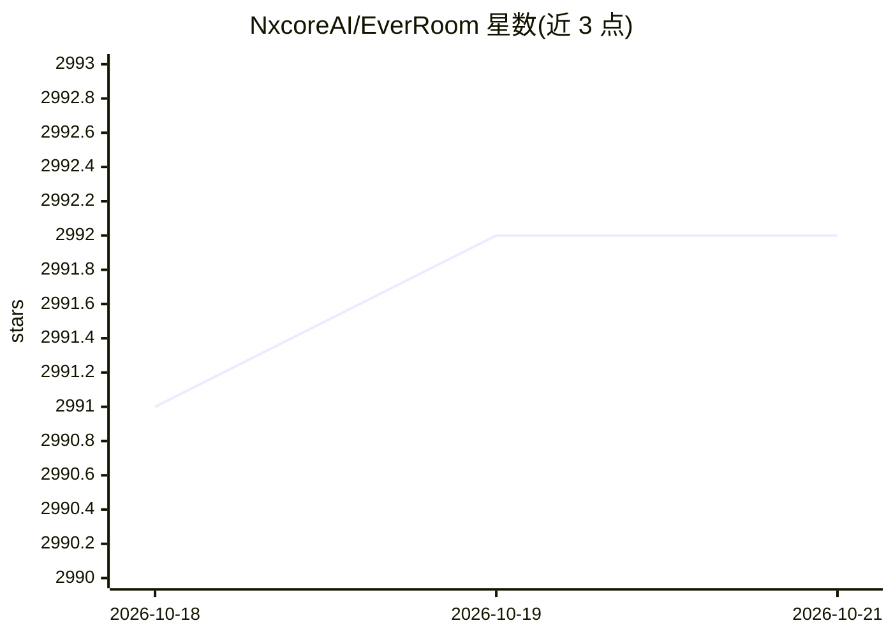

# NxcoreAI/EverRoom

⭐ 2,992 · TypeScript · NOASSERTION · 推送 2026-10-19 · [GitHub](https://github.com/NxcoreAI/EverRoom) · [官网](https://r.nxcore.ai) · 组织维护 · 中文 README

**本地优先的个人上下文工作区：连接文件、对话、记忆与 AI Agent**

Electron + React 桌面应用，附带 Fastify Gateway 服务：将本地文件、仓库、会议、音频及飞书/Slack/Notion/Gmail 等可选服务的信息统一接入，围绕项目组织成 Context Room，提供 Wiki、版本化 Context Docs、MemoryCore L0-L3 记忆管线、带转录的语音捕获，以及范围受限的 Agent 会话与定时任务。Agent 通过 AgentResolver 调用 OpenAI 兼容接口，文档编辑经事务化提交核心，暴露 MCP 文档端点。当前开发目标为 macOS，API 与存储结构可能变更。

## 筛选速览

| 维度 | 判定 | 备注 |
|---|---|---|
| AI 角色 | `ai-native` | 本体是模型或模型工具 |
| 许可风险 | `none` | NOASSERTION |
| 部署形态 | `desktop` | 安装包/桌面程序 |
| 模型依赖 | — | README 未给出锁定关系 |
| 硬件要求 | — | 无带数字的原话,不猜 |
| 安装摩擦 | `low` | 无编译、无系统依赖或容器化 |
| 成熟度 | `idea` | |

## 能力要点

- Context Room 范围化上下文：Agent 只接收当前 Room 的工具与文档
- 证据台账：内容哈希、版本、溯源与策略快照
- MemoryCore L0-L3 分层记忆管线与会话捕获
- MCP 文档端点（/v1/mcp/documents/:sessionId）与文件驱动子 Agent

## 适用场景

- 为项目聚合文件、对话、会议记录并保留可追溯的上下文
- 让 Agent 在限定上下文内撰写和修改可审查的文档
- 跨会话保持个人工作记忆与决策记录

## 场景标签

`知识库管理` `Agent 记忆` · 领域:Agent 开发

## 证据(README 行号)

> L23: Everroom gives your work a place where information, memory, and action stay connected. Bring in the files, conversa
> L42: 4. **Move work forward** with scoped Agent sessions, scheduled tasks, diary automation, and the Agent Office view.
> L103: |Agent sessions|Available|Persistent sessions, runs, streaming events, cancellation, independent runtime sessions,

## 星数曲线

2026-10-18 2,991 → 2026-10-21 2,992（+1）

---
*卡片 v1 · prompt 1.4 · 生成 2026-10-20 · 置信度 mid · 依据 README sha `f3676056c07d` · [字段定义](../../DATASET.md)*
