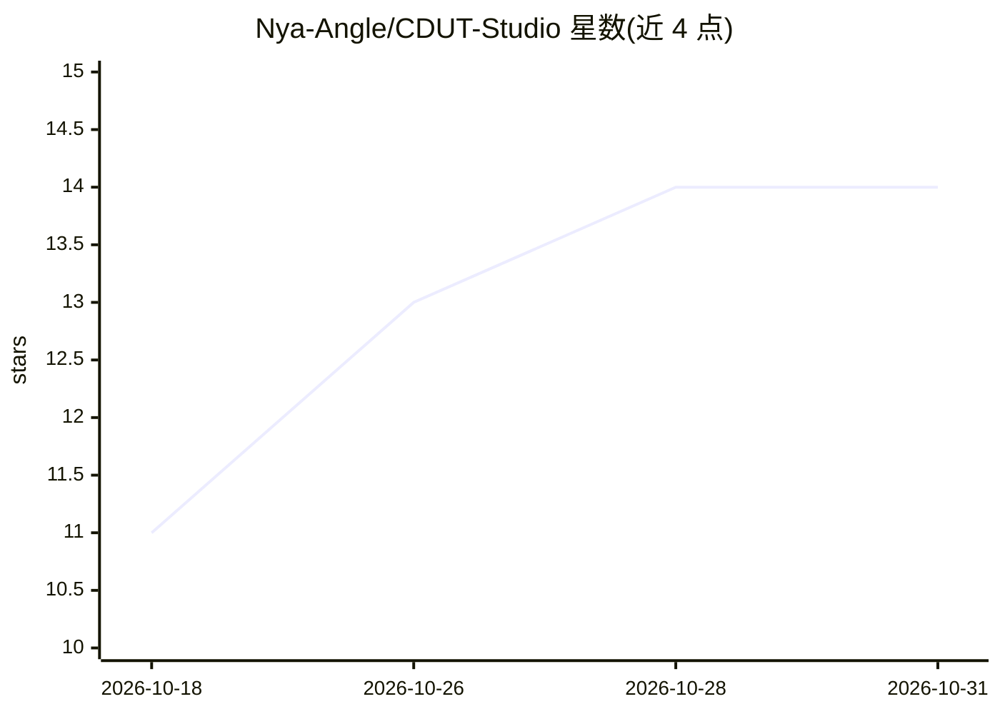

# Nya-Angle/CDUT-Studio

⭐ 14 · TypeScript · AGPL-3.0 · 推送 2026-10-29 · [GitHub](https://github.com/Nya-Angle/CDUT-Studio) · [官网](https://cdut-studio.work) · 组织维护 · 中文 README

**面向成都理工大学师生的本地优先端侧 AI 智能体客户端**

基于 Electron + Bun + React 构建的桌面 AI 智能体客户端，以 Pi Coding Agent 为执行内核，宣称 100% 本地优先。功能分四专区：科学计算（晶体学、PXRD 模拟、WebGPU 等值面）、校园教务（统一身份认证登录、课表/成绩/考场查询）、材料三栏审校（规则编译器、覆盖账本）、AI 速课堂与受管浏览器（AXTree 网页压缩感知）。支持 18 家模型协议适配（DeepSeek/Gemini/Claude 等），凭据经 safeStorage 本地加密。安装需克隆仓库并用 Bun 启动，AGPL-3.0 许可，非官方学生开源项目。README 附 MultiHop-RAG 与 AXTree 压缩两项自测基准。

## 筛选速览

| 维度 | 判定 | 备注 |
|---|---|---|
| AI 角色 | `ai-native` | 本体是模型或模型工具 |
| 许可风险 | `viral` | AGPL-3.0 |
| 部署形态 | `None` |  |
| 模型依赖 | — | README 未给出锁定关系 |
| 硬件要求 | — | 无带数字的原话,不猜 |
| 安装摩擦 | `low` | 无编译、无系统依赖或容器化 |
| 成熟度 | — | 结构信号不足 |

## 能力要点

- 以 Pi Coding Agent 为执行内核，适配 18 家模型协议
- 受管浏览器基于 Chromium 无障碍树做纯文本网页感知，报告平均 90.89% Token 压缩
- 统一身份认证接入校园教务：课表/成绩折算/考场/空教室查询
- 本地长期记忆系统：反思提炼引擎 + 本地 JSON 向量存储 + 设置页全生命周期管理

## 适用场景

- 成理学生查询课表、成绩绩点、考场与空教室
- 科研场景做晶体结构解析、PXRD 模拟与出版级出图
- 奖助学金/评优材料的三栏比对审核
- 期末用课件与考纲生成知识图谱并做薄弱点带教

## 场景标签

`浏览器自动化` `RAG` `知识图谱` `科研工具` · 领域:效率与自动化

## 证据(README 行号)

> L31: > **CDUT Studio** 是一款深度适配**成都理工大学**学术科研与校园生活生态的全功能端侧 AI 智能体（Agent）客户端。
> L121:                     └── 18 家主流模型协议原生适配 (DeepSeek / Gemini / Claude 等)

## 星数曲线

2026-10-18 11 → 2026-10-31 14（+3）

---
*卡片 v1 · prompt 1.4 · 生成 2026-10-31 · 置信度 high · 依据 README sha `77392b3bbedf` · [字段定义](../../DATASET.md)*
