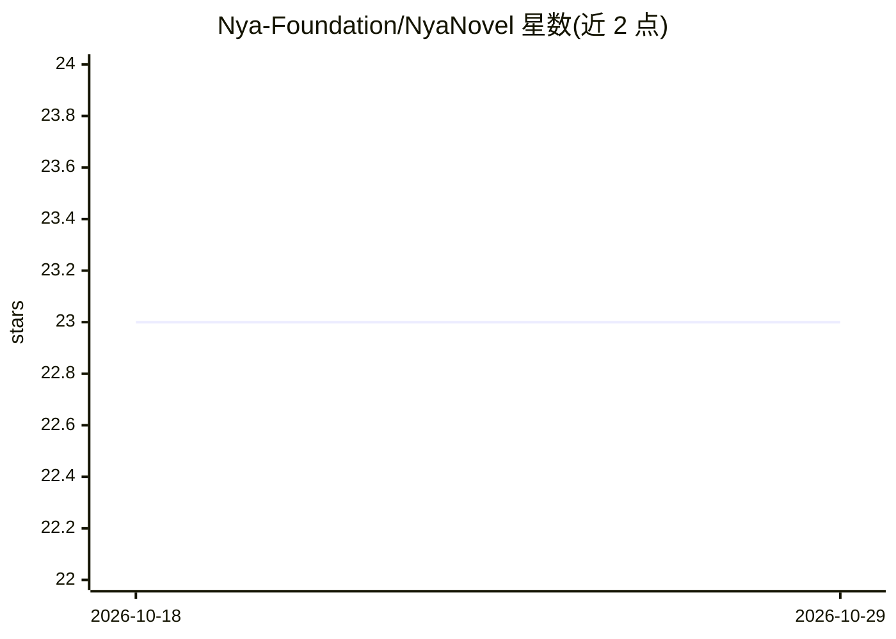

# Nya-Foundation/NyaNovel

⭐ 23 · TypeScript · MIT · 推送 2026-07-20 · [GitHub](https://github.com/Nya-Foundation/NyaNovel) · [官网](https://novelai.moe) · 组织维护

**NovelAI 图像生成的前端浏览器客户端，本地优先**

基于 Next.js App Router 的非官方 NovelAI 图像生成浏览器客户端：通过 nekoai-js 在浏览器直接请求 NovelAI API，覆盖 V4/V4.5/Anime V3/Furry V3 模型的完整生成参数（步数、采样器、CFG、多角色提示、vibe transfer 等）、流式中间帧预览、Director 工具（线稿、去背景、上色、4× 放大等）与 NovelAI 标签建议。无需账户服务器或图片数据库：令牌存于浏览器本地存储，生成图片存于 IndexedDB。使用 Bun 安装依赖并以 git clone 源码运行，另提供多阶段 Docker 镜像（Docker Compose 或 CLI）。生成消耗账户 Anlas。

## 筛选速览

| 维度 | 判定 | 备注 |
|---|---|---|
| AI 角色 | `ai-native` | 本体是模型或模型工具 |
| 许可风险 | `permissive` | MIT |
| 部署形态 | `self-host` | docker 或自建部署 |
| 模型依赖 | — | README 未给出锁定关系 |
| 硬件要求 | — | 无带数字的原话,不猜 |
| 安装摩擦 | `low` | 无编译、无系统依赖或容器化 |
| 成熟度 | — | 结构信号不足 |

## 能力要点

- 浏览器直连 NovelAI，无账户服务器与图片数据库，图像存 IndexedDB
- 流式中间帧实时预览、批内逐样本进度与在途停止
- V4/V4.5 多角色提示与 vibe transfer、Director 多项图片操作
- NovelAI PNG 配方拖放导入与完整生成参数随图保存

## 适用场景

- 在自托管的本地工作台中使用 NovelAI 生成图片并管理历史
- 需要完整生成参数控制与迭代流程的 NovelAI 用户
- 通过 Docker 在自有域名部署私有生图客户端

## 场景标签

`图像生成` · 领域:内容生成

## 证据(README 行号)

> L14: NyaNovel is an unofficial browser client for NovelAI image generation. It keeps the depth of
> L30: - NovelAI Diffusion V4.5 Full and Curated, V4 Full and Curated, Anime V3, and Furry V3.
> L205: With the default configuration, generation traffic goes directly from your browser to NovelAI. If

## 星数曲线

2026-10-18 23 → 2026-10-29 23（+0）

---
*卡片 v1 · prompt 1.4 · 生成 2026-10-27 · 置信度 high · 依据 README sha `696f261993ba` · [字段定义](../../DATASET.md)*
