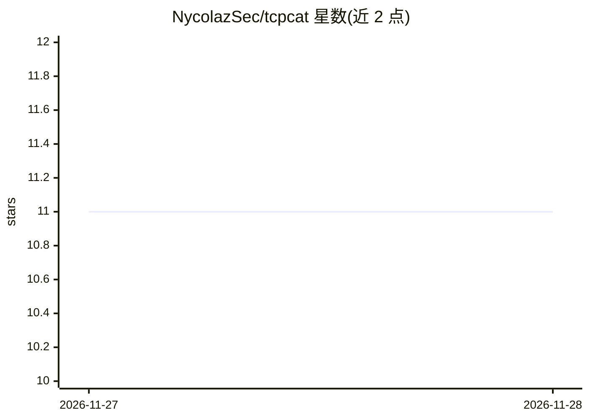

# NycolazSec/tcpcat

⭐ 11 · Go · AGPL-3.0 · 推送 2026-11-27 · [GitHub](https://github.com/NycolazSec/tcpcat) · [官网](https://tcpcat.io) · 个人维护

**给系统管理员的外部端口暴露扫描器，离线 AI 解释每个开放端口**

用 Go 编写的单二进制网络扫描器，从外部视角检查主机暴露面：SYN/UDP/ICMP 扫描、服务与版本与 OS 识别、CVE 关联（OSV/Vulners/离线库，含 CISA KEV/EPSS），并标注每个端口背后的进程/容器/Pod。用户以 YAML 声明应可达范围，policy check 在 CI 中校验；修复后用 Ed25519 签名证据与 replay 命令留证。离线 AI 对扫描结果生成解释与修复顺序。面向无安全团队的小公司、DevOps 与授权渗透测试者。

## 筛选速览

| 维度 | 判定 | 备注 |
|---|---|---|
| AI 角色 | `ai-enhanced` | 去掉 AI 部分产品仍成立 |
| 许可风险 | `dual` | AGPL-3.0 |
| 部署形态 | `desktop` | 安装包/桌面程序 |
| 模型依赖 | — | README 未给出锁定关系 |
| 硬件要求 | — | 无带数字的原话,不猜 |
| 安装摩擦 | `low` | 无编译、无系统依赖或容器化 |
| 成熟度 | — | 结构信号不足 |

## 能力要点

- 扫描+声明式暴露规则校验+签名证据回放的三步流程
- 离线 AI 解释开放端口是什么、为何重要、如何修复
- eBPF/AF_XDP 内核旁路引擎与沙箱化 WASM 检测脚本
- OT/工业网络的保守扫描 profile（full connect、1 连接、5 pps）

## 适用场景

- 审计我负责的服务器从外网实际暴露了哪些端口
- 在 CI 中按 YAML 规则拦截不该开放的服务
- 修复后生成签名证据并回放证明已闭环
- 对工控/OT 网络做低强度授权扫描

## 场景标签

`网络安全` · 领域:学习与行业

## 证据(README 行号)

> L42: tcpcat scanning scanme.nmap.org with --ai-deep: open ports, versions, weak crypto and CVEs, then its AI tells how t
> L103: **tcpcat** checks what the servers and networks you are responsible for expose. Under the hood it is a complete ne
> L107: tcpcat is a dual-licensed project (AGPL-3.0 or commercial) maintained by Nicolas Blondelle (NycolazSec). It is **f

## 星数曲线

2026-11-27 11 → 2026-11-28 11（+0）

---
*卡片 v1 · prompt 1.4 · 生成 2026-11-27 · 置信度 high · 依据 README sha `18f6c35fbb55` · [字段定义](../../DATASET.md)*
