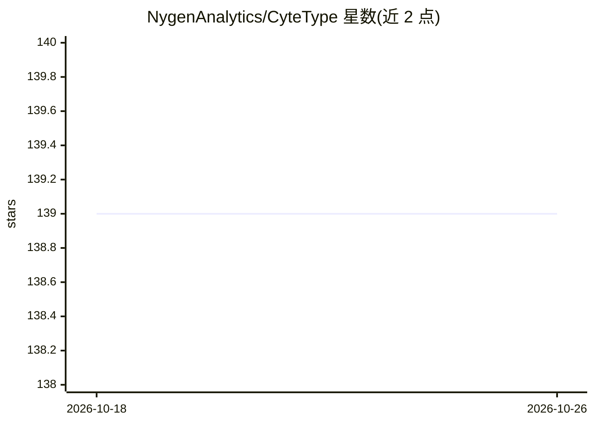

# NygenAnalytics/CyteType

⭐ 139 · Python · BSD-3-Clause · 推送 2026-10-18 · [GitHub](https://github.com/NygenAnalytics/CyteType) · [官网](https://www.biorxiv.org/content/10.1101/2025.11.06.686964v1.full-text) · 组织维护

**面向单细胞 RNA-seq 的多智能体 LLM 细胞类型注释系统**

CyteType 是用于单细胞 RNA 测序数据的端到端细胞类型注释系统，面向构建可重复分析流程的生物信息学研究者。它组合聚类级标记基因、表达上下文、研究元数据与本体映射，经多智能体审校流程生成注释；注释在 CyteType 云服务上运行，需 API key，学术与非商业用途免费（限额度内），商业用途需向 Nygen Analytics 购买许可。直接操作 AnnData 对象，Python 客户端以 BSD 3-Clause 开源，另有 R 客户端 CyteTypeR，并支持自带 LLM 包括本地模型。

## 筛选速览

| 维度 | 判定 | 备注 |
|---|---|---|
| AI 角色 | `ai-native` | 本体是模型或模型工具 |
| 许可风险 | `permissive` | BSD-3-Clause |
| 部署形态 | `library` | 以包/库形式分发 |
| 模型依赖 | — | README 未给出锁定关系 |
| 硬件要求 | — | 无带数字的原话,不猜 |
| 安装摩擦 | `low` | 无编译、无系统依赖或容器化 |
| 成熟度 | — | 结构信号不足 |

## 能力要点

- 组合标记基因/表达上下文/研究元数据/本体映射的多智能体注释流程
- 输出 Cell Ontology CL ID、置信度与支持证据（marker 基因、通路、推理依据）
- 生成含注释决策与审校评估的交互式 HTML 报告，可对话追问
- 支持自带 LLM provider（含本地模型），另有 R 客户端 CyteTypeR 与 MCP connector

## 适用场景

- 对 scRNA-seq 聚类结果做可重复的细胞类型注释
- 跨研究比较需要标准化 Cell Ontology ID 的项目
- 需要证据与置信度支持的细胞注释审校流程

## 场景标签

`多智能体` `数据分析` · 领域:Agent 开发

## 证据(README 行号)

> L18: **CyteType** is an end-to-end cell type annotation system for **single-cell RNA sequencing (scRNA-seq)**, designed 
> L64: - **Annotations:** Cell type, subtype, and activation state for every cluster

## 星数曲线

2026-10-18 139 → 2026-10-26 139（+0）

---
*卡片 v1 · prompt 1.4 · 生成 2026-10-22 · 置信度 high · 依据 README sha `04202b0087a3` · [字段定义](../../DATASET.md)*
