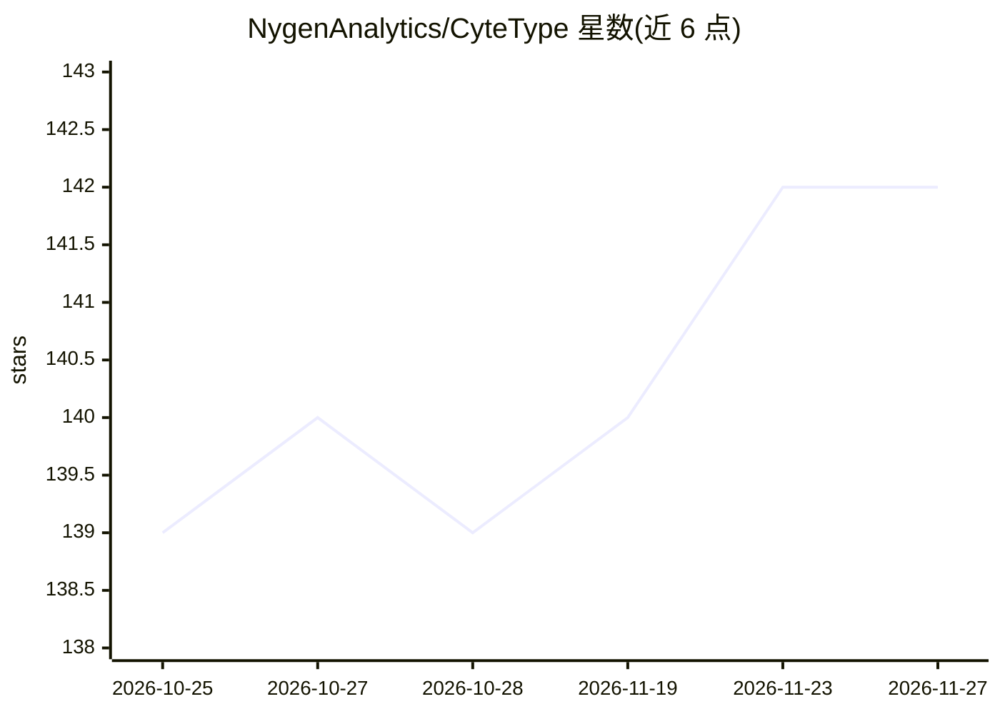

# NygenAnalytics/CyteType

⭐ 142 · Python · BSD-3-Clause · 推送 2026-11-24 · [GitHub](https://github.com/NygenAnalytics/CyteType) · [官网](https://www.biorxiv.org/content/10.1101/2025.11.06.686964v1.full-text) · 组织维护

**单细胞 RNA-seq 细胞类型注释的多智能体 LLM 工具**

以 Python 客户端形式提供的单细胞 RNA-seq 细胞类型注释系统，直接操作 AnnData，将聚类 marker 基因、表达上下文、研究元数据、本体映射与审核步骤组织为结构化工作流。每次分析生成含注释决策、置信分级（High/Moderate/Low）、CL 本体 ID 与证据链的交互式报告，报告内提供 Chat 追问与 MCP 连接器；支持 Seurat 场景的 R 客户端。注释通过 CyteType 云服务运行，需 API key，学术免费、商业需许可。

## 筛选速览

| 维度 | 判定 | 备注 |
|---|---|---|
| AI 角色 | `ai-native` | 本体是模型或模型工具 |
| 许可风险 | `permissive` | BSD-3-Clause |
| 部署形态 | `library` | 以包/库形式分发 |
| 模型依赖 | — | README 未给出锁定关系 |
| 硬件要求 | — | 无带数字的原话,不猜 |
| 安装摩擦 | `low` | 无编译、无系统依赖或容器化 |
| 成熟度 | — | 结构信号不足 |

## 能力要点

- 对 AnnData 输出每个聚类的细胞类型/亚型/激活状态及 CL 本体 ID
- 报告含 reviewer 置信分级、异质性标记与 marker 证据链
- 报告内 Chat 追问、dashboard 任务管理与 MCP 连接器
- 文档支持 Python 与 R（CyteTypeR）双客户端及本地模型接入

## 适用场景

- 为 Scanpy 流程的聚类结果批量标注细胞类型与亚型
- 跨研究比较时生成标准化 CL 本体映射
- 需要可复现注释管线而非一次性提示的研究场景

## 场景标签

`多智能体` `科研工具` · 领域:Agent 开发

## 证据(README 行号)

> L18: **CyteType** is an end-to-end cell type annotation system for **single-cell RNA sequencing (scRNA-seq)**, designed 
> L95: - 🤖 Use your own LLM: LLM providers, including local models.

## 星数曲线

2026-10-25 139 → 2026-11-27 142（+3）

---
*卡片 v1 · prompt 1.4 · 生成 2026-11-27 · 置信度 high · 依据 README sha `c77736272dc3` · [字段定义](../../DATASET.md)*
