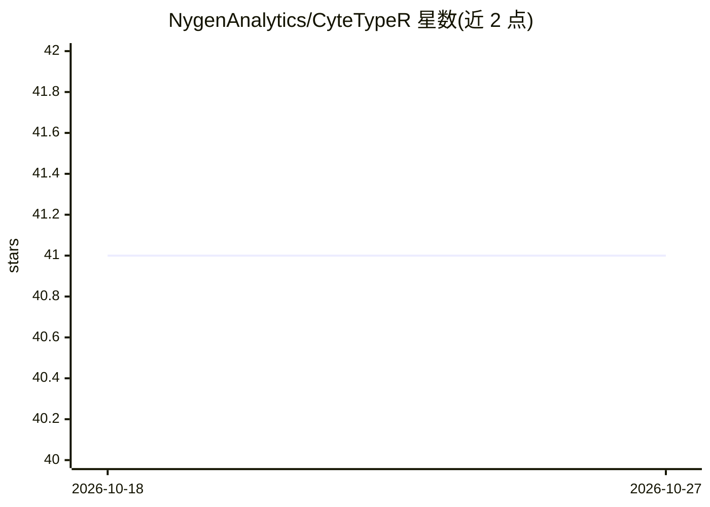

# NygenAnalytics/CyteTypeR

⭐ 41 · R · NOASSERTION · 推送 2026-10-18 · [GitHub](https://github.com/NygenAnalytics/CyteTypeR) · [官网](https://www.biorxiv.org/content/10.1101/2025.11.06.686964v1.full-text) · 组织维护

**面向单细胞 RNA-seq 的 R 端到端细胞类型注释系统**

运行在 Seurat 对象上的 R 包，将 cluster 标记基因、表达上下文、研究元数据、文献检索、本体映射与专门审查步骤组成结构化流程，产出每个 cluster 的细胞类型、Cell Ontology 编号、细胞状态、置信度与证据记录。注释计算通过需 API key 的 CyteType 云端服务完成：学术与非商业用途免费（限内），商业用途需向 Nygen Analytics 购买许可。另提供 CLI 与 Python 客户端（CyteType，面向 AnnData）。需 R 4.2 及以上。

## 筛选速览

| 维度 | 判定 | 备注 |
|---|---|---|
| AI 角色 | `ai-native` | 本体是模型或模型工具 |
| 许可风险 | `permissive` | NOASSERTION |
| 部署形态 | `None` |  |
| 模型依赖 | — | README 未给出锁定关系 |
| 硬件要求 | — | 无带数字的原话,不猜 |
| 安装摩擦 | `low` | 无编译、无系统依赖或容器化 |
| 成熟度 | — | 结构信号不足 |

## 能力要点

- 直接读取 Seurat 对象，注释结果写回 meta.data 与 misc
- 输出 Cell Ontology 编号、细胞状态、置信度及文献证据
- 多 agent 流程：标记分析、文献证据、本体映射与专门审查步骤
- 每次分析生成含证据与对话界面的 HTML 报告

## 适用场景

- 我想给 scRNA-seq 的 cluster 批量生成带本体编号和证据的细胞类型注释
- 在可重复的分析管线（而非一次性对话）中集成注释步骤
- 跨研究比较注释结果时使用标准化 CL 编号

## 场景标签

`科研工具` · 领域:学习与行业

## 证据(README 行号)

> L12: **CyteTypeR** is an end-to-end cell type annotation system for **single-cell RNA sequencing (scRNA-seq)**, designed
> L23: Manual cell type annotation takes weeks and varies between experts. CyteTypeR delivers consistent, expert-level ann

## 星数曲线

2026-10-18 41 → 2026-10-27 41（+0）

---
*卡片 v1 · prompt 1.4 · 生成 2026-10-25 · 置信度 high · 依据 README sha `19c5ac045bb6` · [字段定义](../../DATASET.md)*
