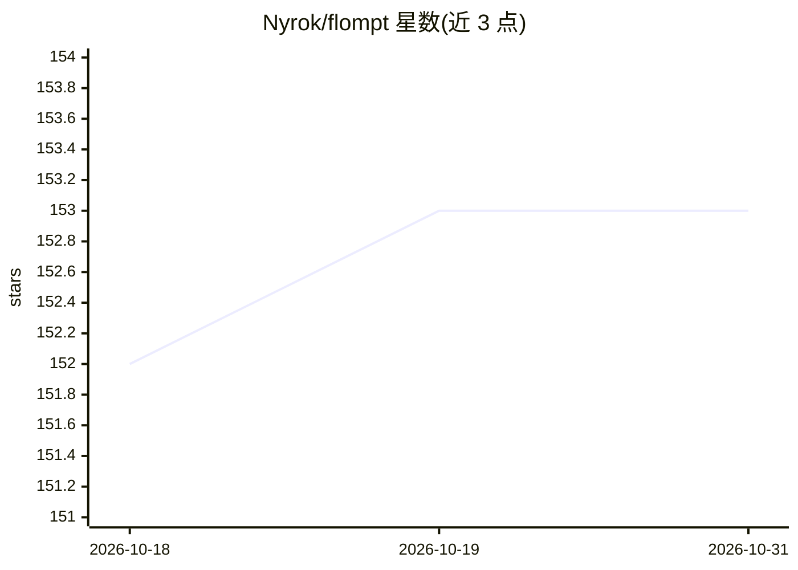

# Nyrok/flompt

⭐ 153 · TypeScript · MIT · 推送 2026-03-30 · [GitHub](https://github.com/Nyrok/flompt) · [官网](https://flompt.dev) · 个人维护

**可视化 AI 提示词构建器：拆解提示词为流程图并编译为 XML**

面向提示词工程的可视化工具：粘贴提示词后由 AI 分解为 16 种类型化结构块，在流程图编辑器中拖拽、连线、重排，再编译为遵循 Anthropic 推荐结构的 XML 提示词并附 token 估算。提供 flompt.dev 在线版（无需账号）、Chrome/Firefox 浏览器扩展（注入 ChatGPT、Claude、Gemini 页面）、以及 Claude Code 的 MCP 工具集成（decompose_prompt/compile_prompt/list_block_types）。无 API key 时退化为关键词启发式分解。技术栈为 React+React Flow 前端与 FastAPI 后端，支持自托管，生产部署使用 Caddy+supervisord。

## 筛选速览

| 维度 | 判定 | 备注 |
|---|---|---|
| AI 角色 | `ai-native` | 本体是模型或模型工具 |
| 许可风险 | `permissive` | MIT |
| 部署形态 | `library` | 以包/库形式分发 |
| 模型依赖 | — | README 未给出锁定关系 |
| 硬件要求 | — | 无带数字的原话,不猜 |
| 安装摩擦 | `low` | 无编译、无系统依赖或容器化 |
| 成熟度 | — | 结构信号不足 |

## 能力要点

- 提示词分解为 16 种类型化块并在流程图中编辑
- 编译为 Claude 优化的 XML 提示词，附 token 估算
- Chrome/Firefox 扩展注入 ChatGPT、Claude、Gemini 聊天页
- Claude Code MCP 集成，3 个工具经 Streamable HTTP 调用
- 无 API key 时可用关键词启发式分解，10 种界面语言

## 适用场景

- 把长提示词拆成结构块，在流程图里调整后重新编译
- 在 ChatGPT/Claude/Gemini 聊天页内直接增强提示词
- 在 Claude Code 会话中调用分解与编译工具，免浏览器操作

## 场景标签

`提示工程` · 领域:Agent 开发

## 证据(README 行号)

> L46: **flompt** is a visual prompt engineering tool.
> L50: 1. Paste any prompt and let the AI break it into structured blocks
> L52: 3. Compile to a Claude-optimized, machine-ready XML prompt
> L454: - 🤖 AI-powered decomposition: paste a prompt, get structured blocks

## 星数曲线

2026-10-18 152 → 2026-10-31 153（+1）

---
*卡片 v1 · prompt 1.4 · 生成 2026-10-22 · 置信度 mid · 依据 README sha `e784f5ac47fb` · [字段定义](../../DATASET.md)*
