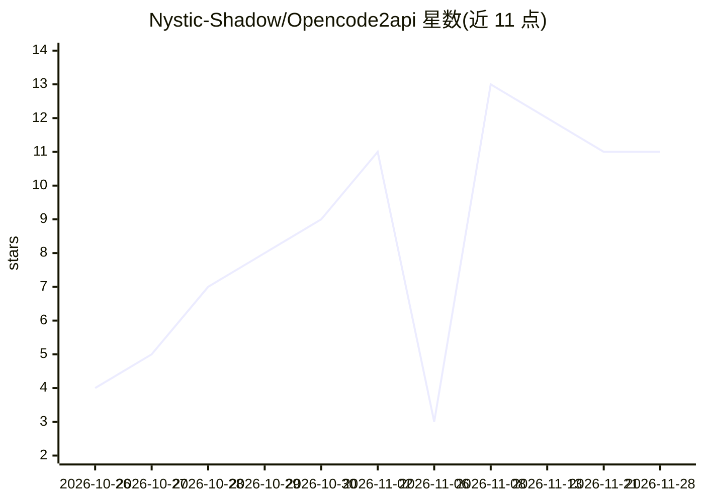

# Nystic-Shadow/Opencode2api

⭐ 11 · JavaScript · MIT · 推送 2026-10-31 · [GitHub](https://github.com/Nystic-Shadow/Opencode2api) · 个人维护

**把 OpenCode Zen 免费层转成 OpenAI/Anthropic 兼容 API 的网关**

OpenCode2API 将标准 OpenAI（/v1/chat/completions）与 Anthropic（/v1/messages）请求翻译到 OpenCode Zen 推理端点，可在 Cursor、VS Code（Continue/Cline）、LibreChat、官方 SDK、LangChain、LiteLLM 等客户端中原生使用。内置 React 控制面板提供请求遥测、playground、作用域 API key 管理与代理诊断；针对上游按 IP 限额的匿名免费层，提供轮换代理、本地守护进程、Zen Key 与代理池四种出口策略。README 明确声明仅供教育与协议研究用途。

## 筛选速览

| 维度 | 判定 | 备注 |
|---|---|---|
| AI 角色 | `ai-ecosystem` | LLM/agent 周边工具 |
| 许可风险 | `permissive` | MIT |
| 部署形态 | `self-host` | docker 或自建部署 |
| 模型依赖 | — | README 未给出锁定关系 |
| 硬件要求 | — | 无带数字的原话,不猜 |
| 安装摩擦 | `low` | 无编译、无系统依赖或容器化 |
| 成熟度 | — | 结构信号不足 |

## 能力要点

- OpenAI 与 Anthropic 双协议兼容的统一网关，支持 SSE 流式与 reasoning 轨迹
- 自动发现、验证、延迟排序、轮换与淘汰代理池（面向美国出口）
- Bun TLS 指纹桥接以匹配 OpenCode CLI 客户端指纹
- React 控制面板：实时遥测、playground、O2P- key 管理与代理诊断

## 适用场景

- 在 Cursor、Cline、LibreChat 等客户端接入 OpenCode Zen 模型
- 本地运行以使用家庭宽带 IP 获得零成本匿名额度
- 云服务器部署时配置轮换代理或 Zen Key 处理按 IP 限额

## 场景标签

`模型网关` · 领域:Agent 开发

## 证据(README 行号)

> L5: ### High-Performance OpenAI & Anthropic Compatible Gateway for OpenCode Models
> L27: OpenCode2API acts as a drop-in gateway translating standard **OpenAI** (`/v1/chat/completions`) and **Anthropic** (
> L33: - **Built-in Control Plane**: React-based dashboard with live request telemetry, interactive playground, scoped `O2

## 星数曲线

2026-10-26 4 → 2026-11-28 11（+7）

---
*卡片 v1 · prompt 1.4 · 生成 2026-11-18 · 置信度 high · 依据 README sha `070653d25990` · [字段定义](../../DATASET.md)*
