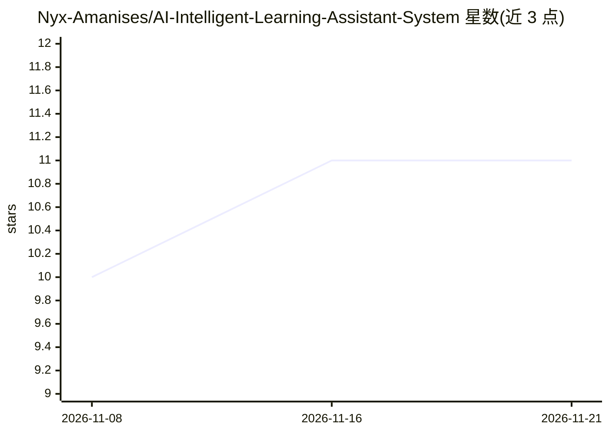

# Nyx-Amanises/AI-Intelligent-Learning-Assistant-System

⭐ 11 · TSQL · 推送 2026-11-09 · [GitHub](https://github.com/Nyx-Amanises/AI-Intelligent-Learning-Assistant-System) · [官网](https://ai-intelligent-learning-assistant-s.vercel.app) · 个人维护 · 中文 README

**全栈 AI 学习助手：资料 RAG 检索、AI 出题总结与学习分析**

面向学生与课程设计场景的全栈 Web 系统，围绕「资料管理→RAG 检索→AI 总结/出题→在线练习→错题复盘→学习分析→Agent 助手」组织功能闭环。后端 Spring Boot 3.3 + Java 17，前端 Vue 3 + Element Plus，向量检索基于 Qdrant，缓存用 Redis，数据由 Flyway 管理。AI 部分支持 Chat 与 Embedding 模型分开配置、OpenAI 兼容接口、Mock 模式演示，Agent 助手支持 SSE 流式回复与系统上下文工具调用，并内置 Hit@K/Recall@K/MRR 检索评测。README 定位为学习与简历参考项目。

## 筛选速览

| 维度 | 判定 | 备注 |
|---|---|---|
| AI 角色 | `ai-native` | 本体是模型或模型工具 |
| 许可风险 | `none` | — |
| 部署形态 | `self-host` | docker 或自建部署 |
| 模型依赖 | locked-api |  |
| 硬件要求 | — | 无带数字的原话,不猜 |
| 安装摩擦 | `low` | 无编译、无系统依赖或容器化 |
| 成熟度 | — | 结构信号不足 |

## 能力要点

- 基于 Qdrant 的资料向量检索，支持页码/相似度/章节引用
- 内置 RAG 评测集管理，支持 Hit@K、Recall@K、MRR 与多方案对比
- Agent 学习助手支持 SSE 流式回复与工具调用轨迹
- 支持 Mock 模式，无真实模型 Key 时可演示流程

## 适用场景

- 上传课程资料后生成 AI 总结与练习题，进行在线练习与错题复盘
- 对学习资料做 RAG 检索质量评测与调参对比
- 作为 AI 应用实战与简历项目的参考案例

## 场景标签

`RAG` `模型评测` · 领域:评测与运维

## 证据(README 行号)

> L5: > 一个围绕“资料管理 -> RAG 检索 -> AI 总结/出题 -> 在线练习 -> 错题复盘 -> 学习分析 -> Agent 学习助手”构建的全栈 AI 学习闭环项目。
> L14: - **工程化 RAG 能力**：基于 Qdrant 的资料向量检索，支持引用页码、相似度、章节信息和 Hit@K / Recall@K / MRR 评测。
> L15: - **Agent 工具调用**：学习助手支持 SSE 流式回复，并能查询资料、题集、练习记录、任务状态等系统上下文。

## 星数曲线

2026-11-08 10 → 2026-11-21 11（+1）

---
*卡片 v1 · prompt 1.4 · 生成 2026-11-19 · 置信度 high · 依据 README sha `27b08c16c5b7` · [字段定义](../../DATASET.md)*
