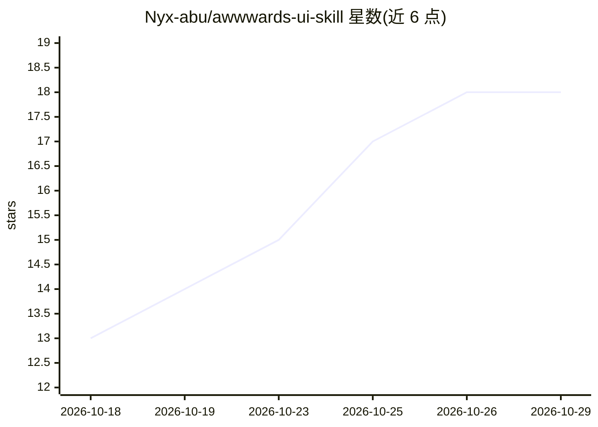

# Nyx-abu/awwwards-ui-skill

⭐ 18 · JavaScript · MIT · 推送 2026-06-21 · [GitHub](https://github.com/Nyx-abu/awwwards-ui-skill) · 个人维护

**提升 AI 生成 UI 设计质量的 agent 技能包**

面向 Claude Code、Codex 与 Antigravity 的开源技能（SKILL.md）：将动效、排版、配色、无障碍等设计意图注入 agent 上下文，替代其默认的通用化布局。要求 agent 返回代码前通过 UI-Max Scorecard（目标 88/100）自审，覆盖动效分层、首屏构图、WCAG AA 对比度、375/768/1440px 响应式等 9 项指标；提供 npx 自动安装器与手动 clone 方式，附带确定性校验测试与示例站点。

## 筛选速览

| 维度 | 判定 | 备注 |
|---|---|---|
| AI 角色 | `ai-ecosystem` | LLM/agent 周边工具 |
| 许可风险 | `permissive` | MIT |
| 部署形态 | `library` | 以包/库形式分发 |
| 模型依赖 | — | README 未给出锁定关系 |
| 硬件要求 | — | 无带数字的原话,不猜 |
| 安装摩擦 | `low` | 无编译、无系统依赖或容器化 |
| 成熟度 | — | 结构信号不足 |

## 能力要点

- 以 SKILL.md 注入动效/排版/配色/交互设计意图到 agent 上下文
- UI-Max Scorecard（88/100 门槛）将设计质量转为可审计的通过项
- 覆盖 GSAP/Lenis 动效、Three.js 粒子场、WCAG AA 无障碍等设计规范
- 关键词自动触发（cool ui / premium design / awwwards style）

## 适用场景

- 让 AI agent 生成达到 Awwwards 风格水准的网站与落地页
- 在 agent 输出 UI 代码前自动审查无障碍与性能指标
- 为开发者作品集、代理商站点生成有设计意图的界面

## 场景标签

`代码生成` · 领域:编码与开发

## 证据(README 行号)

> L9: An open-source skill that raises the design quality of AI-generated web interfaces. When AI agents build UIs without
> L11: Compatible with **Antigravity**, **Claude Code**, and **Codex**.
> L62: The skill auto-triggers on keywords like `cool ui`, `premium design`, and `awwwards style`. The agent will apply st

## 星数曲线

2026-10-18 13 → 2026-10-29 18（+5）

---
*卡片 v1 · prompt 1.4 · 生成 2026-10-29 · 置信度 high · 依据 README sha `0ea3e28cb112` · [字段定义](../../DATASET.md)*
