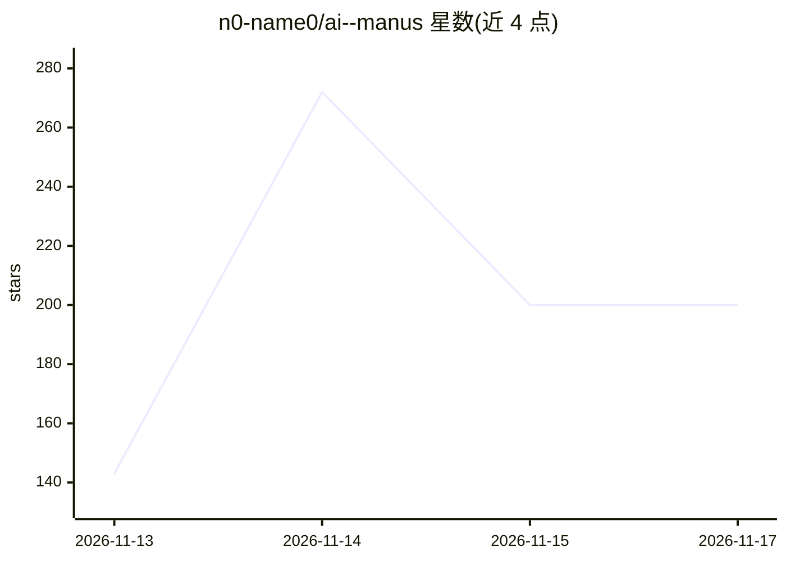

# n0-name0/ai--manus

⭐ 200 · Apache-2.0 · 推送 2026-11-15 · [GitHub](https://github.com/n0-name0/ai--manus) · 个人维护

**自主执行代码与控制浏览器的通用 AI Agent 桌面助手**

README 介绍 Manus 为自主 AI Agent：可自行编写并执行脚本、控制浏览器（导航页面、填写表单、抓取信息）、执行多步骤任务，面向家庭、学习与轻量办公场景的用户，定位为后台个人助理而非企业平台。README 列出 CPU/内存/存储等兼容性参考表。但全文为营销式描述，未给出任何安装命令、运行方式或具体技术实现细节，另含 "Download Manus / PROMO2026" 等链接提示，代码与文档的可验证性有限。

## 筛选速览

| 维度 | 判定 | 备注 |
|---|---|---|
| AI 角色 | `ai-native` | 本体是模型或模型工具 |
| 许可风险 | `permissive` | Apache-2.0 |
| 部署形态 | `None` |  |
| 模型依赖 | — | README 未给出锁定关系 |
| 硬件要求 | — | 无带数字的原话,不猜 |
| 安装摩擦 | `low` | 无编译、无系统依赖或容器化 |
| 成熟度 | — | 结构信号不足 |

## 能力要点

- 自主编写并执行代码完成任务的 Agent
- 浏览器控制：导航网页、填写表单、采集信息
- 代码与浏览器操作可在同一任务流中衔接
- 面向家庭/学习/轻办公的小型化定位

## 适用场景

- 让 Agent 代为执行重复性的脚本与网页操作
- 整理研究资料、运行小脚本、组织笔记
- 从多个网页收集信息并准备摘要

## 场景标签

`AI 助手` `浏览器自动化` `编码 Agent` · 领域:效率与自动化

## 证据(README 行号)

> L10: - **Autonomous Code Execution:** Manus AI agent runs code on its own to complete tasks, so you can focus on decisio
> L18: Manus is an autonomous AI agent designed to run code and control a browser on your behalf. Instead of acting like a

## 星数曲线

2026-11-13 143 → 2026-11-17 200（+57）

---
*卡片 v1 · prompt 1.4 · 生成 2026-11-17 · 置信度 low · 依据 README sha `0f78ee3a5dd2` · [字段定义](../../DATASET.md)*
