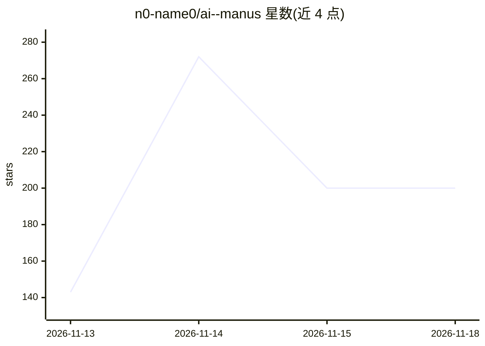

# n0-name0/ai--manus

⭐ 200 · Apache-2.0 · 推送 2026-11-17 · [GitHub](https://github.com/n0-name0/ai--manus) · 个人维护

**面向个人用户的自主 AI Agent：代写代码、操控浏览器**

README 以产品介绍形式描述一个名为 Manus 的自主 AI Agent：代理用户编写并执行脚本、控制浏览器（导航网页、填写表单、多步骤任务），定位为家庭、学习与轻办公场景的后台个人助手。仓库描述补充说明其在沙箱环境中运行多种工具与操作。README 未给出源码结构、安装命令或 API 使用方式，仅含下载入口（Download Manus / PROMO2026）、兼容性硬件表与使用建议，属于面向终端用户的产品页式文档。

## 筛选速览

| 维度 | 判定 | 备注 |
|---|---|---|
| AI 角色 | `ai-native` | 本体是模型或模型工具 |
| 许可风险 | `permissive` | Apache-2.0 |
| 部署形态 | `None` |  |
| 模型依赖 | — | README 未给出锁定关系 |
| 硬件要求 | — | 无带数字的原话,不猜 |
| 安装摩擦 | `low` | 无编译、无系统依赖或容器化 |
| 成熟度 | — | 结构信号不足 |

## 能力要点

- 自主执行代码与控制浏览器完成多步骤任务
- 代码与浏览器操作可在同一工作流中衔接
- 后台常驻的个人助手形态，面向小型任务
- 沙箱环境中运行各类工具与操作（仓库描述）

## 适用场景

- 让 AI 代为完成重复性的脚本执行与网页操作
- 学生学习研究中整理资料、跑小计算
- 轻量办公中跨多个网页收集信息并汇总

## 场景标签

`AI 助手` `浏览器自动化` `编码 Agent` · 领域:效率与自动化

## 证据(README 行号)

> L10: - **Autonomous Code Execution:** Manus AI agent runs code on its own to complete tasks, so you can focus on decisio
> L18: Manus is an autonomous AI agent designed to run code and control a browser on your behalf. Instead of acting like a

## 星数曲线

2026-11-13 143 → 2026-11-18 200（+57）

---
*卡片 v1 · prompt 1.4 · 生成 2026-11-18 · 置信度 low · 依据 README sha `c06e59c45084` · [字段定义](../../DATASET.md)*
