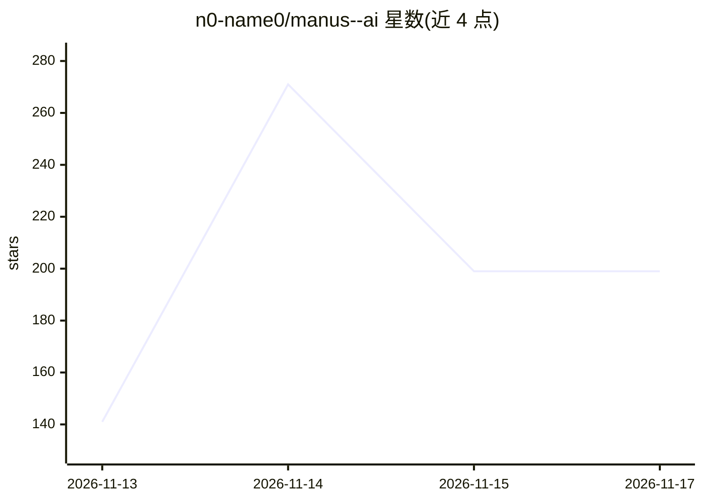

# n0-name0/manus--ai

⭐ 199 · Apache-2.0 · 推送 2026-11-15 · [GitHub](https://github.com/n0-name0/manus--ai) · 个人维护

**自主 AI 代理：代用户执行代码与控制浏览器完成任务**

名为 Manus 的自主 AI 代理，面向个人/轻量场景：用户以自然语言下达指令，代理自行编写并执行脚本、控制浏览器（导航网页、填写表单、采集信息），完成多步骤任务，可在后台作为个人助手持续待命并跨会话重复执行相同工作流。README 未给出具体技术实现细节、模型接入方式或安装命令，主要描述能力与适用场景，并列出最低 4 GB 内存等兼容性要求。

## 筛选速览

| 维度 | 判定 | 备注 |
|---|---|---|
| AI 角色 | `ai-native` | 本体是模型或模型工具 |
| 许可风险 | `permissive` | Apache-2.0 |
| 部署形态 | `None` |  |
| 模型依赖 | — | README 未给出锁定关系 |
| 硬件要求 | — | 无带数字的原话,不猜 |
| 安装摩擦 | `low` | 无编译、无系统依赖或容器化 |
| 成熟度 | — | 结构信号不足 |

## 能力要点

- 自主编写并执行代码完成任务
- 浏览器控制：导航、填表、信息采集
- 多步骤任务执行，最小监督
- 跨会话记住并重复工作流

## 适用场景

- 让学生组织研究笔记、运行小脚本
- 远程工作者从多页面采集数据
- 日常重复性小任务的后台自动化

## 场景标签

`AI 助手` `编码 Agent` `浏览器自动化` · 领域:效率与自动化

## 证据(README 行号)

> L18: Manus is an autonomous AI agent designed to run code and control a browser on your behalf. Instead of acting like a
> L10: - **Autonomous Code Execution:** Manus AI agent runs code on its own to complete tasks, so you can focus on decisio

## 星数曲线

2026-11-13 141 → 2026-11-17 199（+58）

---
*卡片 v1 · prompt 1.4 · 生成 2026-11-17 · 置信度 mid · 依据 README sha `fbfd5e977bf4` · [字段定义](../../DATASET.md)*
