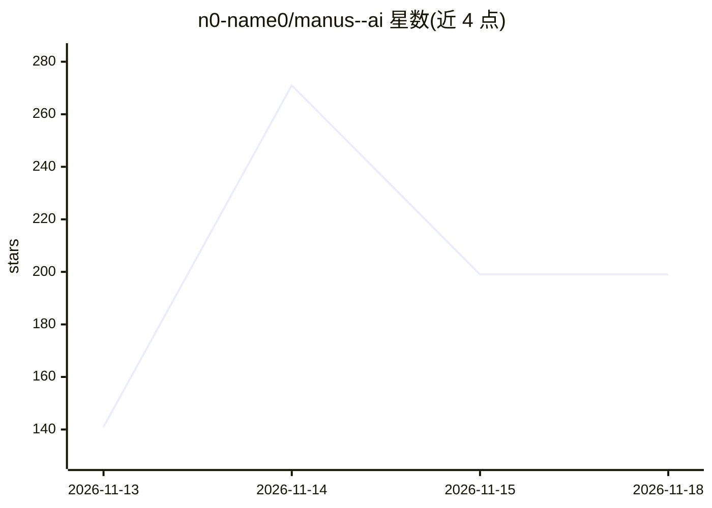

# n0-name0/manus--ai

⭐ 199 · Apache-2.0 · 推送 2026-11-17 · [GitHub](https://github.com/n0-name0/manus--ai) · 个人维护

**面向日常任务的自主 AI Agent：自动写代码并控制浏览器**

以个人助理为定位的自主 AI Agent：自主编写并执行脚本、控制浏览器导航与表单填写，将脚本操作与浏览器操作串联完成多步任务，供学生、远程办公者与小项目使用者以最少监督方式完成日常重复性工作。README 描述其跨会话记忆工作流模式，并给出最低双核 CPU、4GB 内存的兼容性表格与配置/测试步骤。仓库主题标签提及 OpenAI、Anthropic、Gemini 等，但 README 正文未给出具体接入方式。

## 筛选速览

| 维度 | 判定 | 备注 |
|---|---|---|
| AI 角色 | `ai-native` | 本体是模型或模型工具 |
| 许可风险 | `permissive` | Apache-2.0 |
| 部署形态 | `None` |  |
| 模型依赖 | — | README 未给出锁定关系 |
| 硬件要求 | — | 无带数字的原话,不猜 |
| 安装摩擦 | `low` | 无编译、无系统依赖或容器化 |
| 成熟度 | — | 结构信号不足 |

## 能力要点

- 自主编写并执行代码完成任务
- 浏览器控制：导航、填表、跨页收集信息
- 脚本与浏览器操作在单一流程中衔接
- 面向家庭、学习与轻量工作的小规模场景

## 适用场景

- 让 agent 代为执行网页查资料、填表等重复操作
- 组织研究笔记、跑小型脚本与快速计算
- 小型开发实验中自动执行并对比结果

## 场景标签

`AI 助手` `编码 Agent` `浏览器自动化` `工作流自动化` · 领域:效率与自动化

## 证据(README 行号)

> L10: - **Autonomous Code Execution:** Manus AI agent runs code on its own to complete tasks, so you can focus on decisio
> L18: Manus is an autonomous AI agent designed to run code and control a browser on your behalf. Instead of acting like a
> L22: Manus is not a heavy studio suite or a complex enterprise platform. It is a focused helper built for home, study, a

## 星数曲线

2026-11-13 141 → 2026-11-18 199（+58）

---
*卡片 v1 · prompt 1.4 · 生成 2026-11-18 · 置信度 low · 依据 README sha `32e48e22fb91` · [字段定义](../../DATASET.md)*
