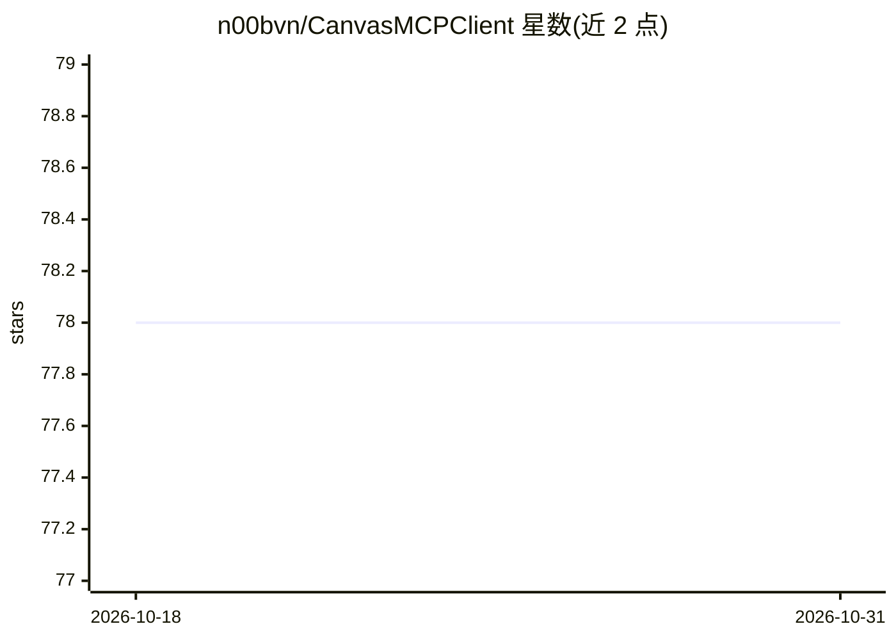

# n00bvn/CanvasMCPClient

⭐ 78 · TypeScript · MIT · 推送 2026-02-11 · [GitHub](https://github.com/n00bvn/CanvasMCPClient) · [官网](https://canvas-mcp.com) · 组织维护

**自托管无限画布仪表盘：统一连接多个 MCP 服务器**

开源、可自托管的可视化仪表盘应用：以无限缩放平移画布为载体，通过 12+ 种组件（便签、AI 对话、看板、表格等）组织工作区，并基于 FastMCP 库连接多个 MCP 服务器，支持 stdio/HTTP/SSE 传输。可配置 OpenAI、Anthropic、Ollama、Google 等多种 AI 提供商。数据存储于本地 SQLite（支持 PostgreSQL），不外传遥测。前端 Next.js 15 + React 19，后端 FastAPI，提供 Docker 一键部署或 Node.js 18+/Python 3.10+ 手动安装两种方式。

## 筛选速览

| 维度 | 判定 | 备注 |
|---|---|---|
| AI 角色 | `ai-ecosystem` | LLM/agent 周边工具 |
| 许可风险 | `permissive` | MIT |
| 部署形态 | `self-host` | docker 或自建部署 |
| 模型依赖 | local-ok | 支持本地模型 |
| 硬件要求 | — | 无带数字的原话,不猜 |
| 安装摩擦 | `low` | 无编译、无系统依赖或容器化 |
| 成熟度 | — | 结构信号不足 |

## 能力要点

- 通过 FastMCP 连接多个 MCP 服务器，支持 stdio/HTTP/SSE 传输
- 无限画布 + 12 种预置组件与无代码组件构建器
- 多 AI 提供商配置（OpenAI/Anthropic/Ollama/Google），凭据加密存储
- 本地 SQLite 存储、无遥测的本地优先架构

## 适用场景

- 在一个画布工作区里集中管理并使用多个 MCP 服务器的工具
- 搭建个人或团队的自定义 AI 工作台仪表盘
- 保存并分享组件与仪表盘模板

## 场景标签

`AI 助手` · 领域:对话与助手

## 证据(README 行号)

> L12: Canvas MCP Client is an **open-source, self-hostable dashboard application** built around an infinite, zoomable, an
> L19: - 🤖 **MCP Integration**: Seamlessly connect to multiple MCP servers using the FastMCP library
> L60:  - Support for stdio, HTTP, and SSE transport protocols

## 星数曲线

2026-10-18 78 → 2026-10-31 78（+0）

---
*卡片 v1 · prompt 1.4 · 生成 2026-10-24 · 置信度 high · 依据 README sha `a813524f343d` · [字段定义](../../DATASET.md)*
