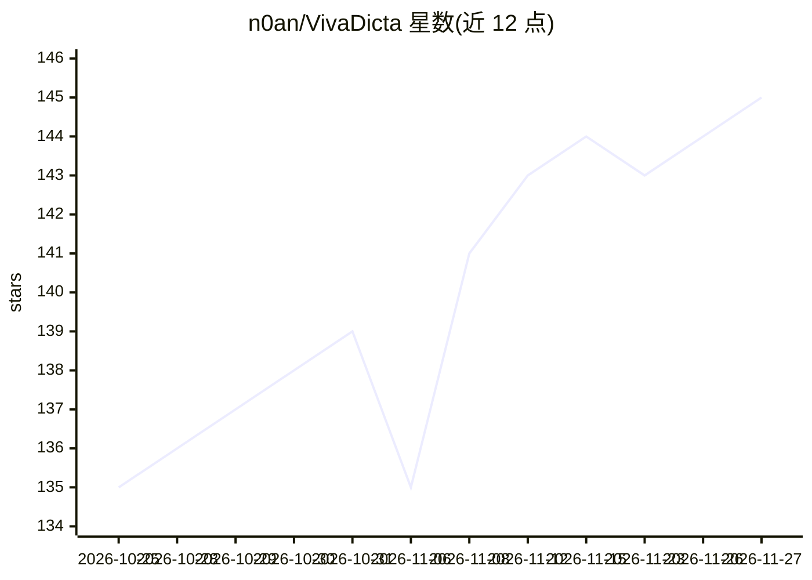

# n0an/VivaDicta

⭐ 145 · Swift · MIT · 推送 2026-11-22 · [GitHub](https://github.com/n0an/VivaDicta) · [官网](https://vivadicta.com/ios) · 个人维护

**iOS/watchOS 语音转写应用：全系统 AI 语音键盘与笔记 RAG 问答**

VivaDicta 是一款 iOS/watchOS 应用，录制语音并通过本地（WhisperKit、Parakeet）或云端模型转写，再可选经 AI 处理。核心功能为系统级 AI 语音键盘，可在任意应用中听写并对选中文本执行改写、翻译、总结等预设；支持笔记的单篇/多篇聊天与语义搜索，基于设备端 RAG 管道（LumoKit/VecturaKit 分块、嵌入、向量检索）并附来源引用。支持 11 个转写源、20+ AI 提供方、OAuth 登录及经 VivAgents 路由到 Mac 上的 CLI agent，通过 CloudKit 跨设备同步。需 Xcode 26+ 构建，本地转写模型首次使用时下载。

## 筛选速览

| 维度 | 判定 | 备注 |
|---|---|---|
| AI 角色 | `ai-native` | 本体是模型或模型工具 |
| 许可风险 | `permissive` | MIT |
| 部署形态 | `None` |  |
| 模型依赖 | local-ok | 支持本地模型 |
| 硬件要求 | — | 无带数字的原话,不猜 |
| 安装摩擦 | `low` | 无编译、无系统依赖或容器化 |
| 成熟度 | — | 结构信号不足 |

## 能力要点

- 系统级 AI 语音键盘：任意应用内听写、改写选中文本
- 设备端 RAG 与语义搜索，数据不离设备，回答带引用
- 本地转写模型 WhisperKit 与 NVIDIA Parakeet（CoreML/ANE）
- 20+ AI 提供方、OAuth 登录、VivAgents CLI agent 桥接

## 适用场景

- 在 Messages/Slack 等任意应用中语音听写并 AI 加工文本
- 对录音笔记提问、提取待办、跨笔记比较主题
- 会议与访谈场景的说话人分离转写
- 在 Apple Watch 上录语音笔记并后台转写

## 场景标签

`语音识别` `RAG` `语义搜索` `文档问答` · 领域:知识与检索

## 证据(README 行号)

> L21: VivaDicta records speech, transcribes it using on-device or cloud models, and optionally processes the text through
> L57: - **Fully on-device RAG pipeline** - chunking, vector embedding, similarity search via LumoKit/VecturaKit - no serv
> L64: - 20+ providers: Apple Foundation Models (on-device, free), Anthropic, OpenAI, Gemini, GitHub Copilot, Groq, Mistra

## 星数曲线

2026-10-25 135 → 2026-11-27 145（+10）

---
*卡片 v1 · prompt 1.4 · 生成 2026-11-27 · 置信度 high · 依据 README sha `8d46bfd9edb7` · [字段定义](../../DATASET.md)*
