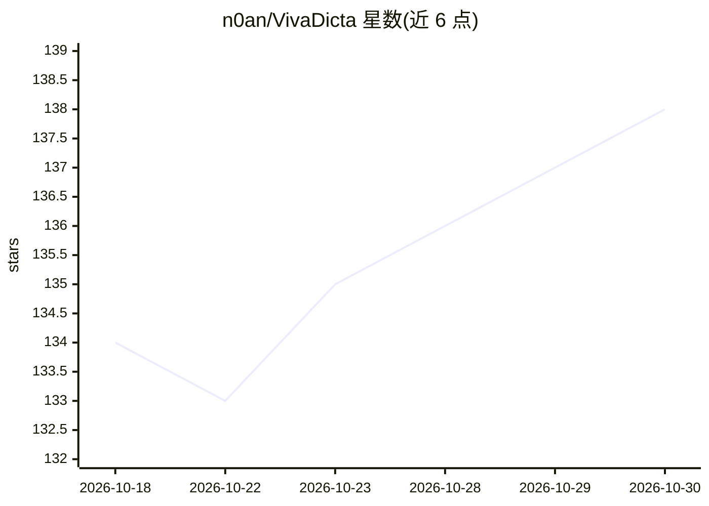

# n0an/VivaDicta

⭐ 138 · Swift · MIT · 推送 2026-10-25 · [GitHub](https://github.com/n0an/VivaDicta) · [官网](https://vivadicta.com/ios) · 个人维护

**iOS/watchOS 语音转文字应用，含 AI 语音键盘与本地 RAG 笔记问答**

面向 iPhone 与 Apple Watch 用户的语音听写应用：录制语音后经端侧（WhisperKit、NVIDIA Parakeet）或云端模型转录为文字，可再经 20+ AI 提供商（含 Apple Foundation Models 端侧免费处理）做改写、翻译、摘要等预设处理。核心特性是系统级 AI 语音键盘，可在任意应用内听写并就地改写选中文本；笔记支持完全端侧的 RAG 管线（分块、向量索引、语义搜索与带引用回答）。支持 OAuth 登录 ChatGPT/Gemini/Copilot，可经 Mac 上的 CLI agent 路由 AI 请求，经 CloudKit 跨设备同步。需 Xcode 26+、iOS 18+ 从源码构建，App Store 亦有分发。

## 筛选速览

| 维度 | 判定 | 备注 |
|---|---|---|
| AI 角色 | `ai-native` | 本体是模型或模型工具 |
| 许可风险 | `permissive` | MIT |
| 部署形态 | `None` |  |
| 模型依赖 | local-ok | 支持本地模型 |
| 硬件要求 | — | 无带数字的原话,不猜 |
| 安装摩擦 | `low` | 无编译、无系统依赖或容器化 |
| 成熟度 | — | 结构信号不足 |

## 能力要点

- 系统级 AI 语音键盘：任意应用内听写与选中文本就地改写
- 端侧转录（WhisperKit/NVIDIA Parakeet）与 11 种云端转录提供商
- 完全端侧 RAG 管线：分块、向量索引、语义搜索与带引用回答
- 20+ AI 提供商，含 Apple Foundation Models 端侧处理与 OAuth 登录

## 适用场景

- 在任意应用里用语音听写并让 AI 就地改写、翻译或摘要
- 对录音笔记提问、提取行动项并做多笔记对比
- 用端侧语义搜索按含义检索全部笔记

## 场景标签

`语音识别` `RAG` · 领域:知识与检索

## 证据(README 行号)

> L21: VivaDicta records speech, transcribes it using on-device or cloud models, and optionally processes the text through
> L39: - **On-device** - WhisperKit (OpenAI Whisper), Parakeet (NVIDIA) - professional-grade models running entirely on yo
> L57: - **Fully on-device RAG pipeline** - chunking, vector embedding, similarity search via LumoKit/VecturaKit - no serv

## 星数曲线

2026-10-18 134 → 2026-10-30 138（+4）

---
*卡片 v1 · prompt 1.4 · 生成 2026-10-22 · 置信度 high · 依据 README sha `f15ad986ce1a` · [字段定义](../../DATASET.md)*
