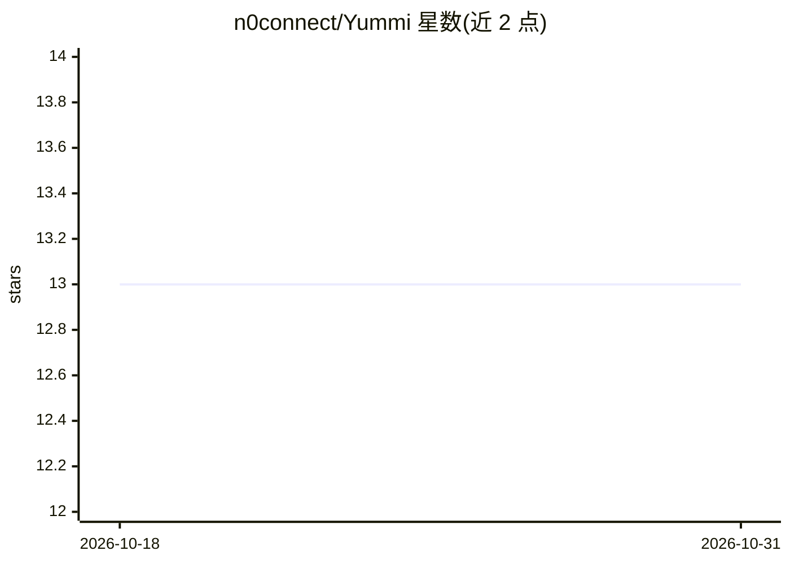

# n0connect/Yummi

⭐ 13 · Go · Apache-2.0 · 推送 2026-10-27 · [GitHub](https://github.com/n0connect/Yummi) · 个人维护

**AI 渗透测试指挥平台：自然语言驱动 Kali 沙箱红队作业**

面向渗透测试人员的自治红队平台：操作员给定目标与一句话目标，Go 编排器内的 agent（12 节点 Graph 状态机或 Eino ADK 后端）规划并在加固 Kali Linux 沙箱中执行，沙箱提供 MCP 工具目录、浏览器自动化、tmux 终端、Metasploit/Impacket 等工具与专科子 agent。独立 Rust 网关通过 nftables 实施 fail-closed 出口管控（四种模式，重启复位 block_all），策略变更以 SHA-256 哈希链审计。支持本地 Ollama 或 OpenRouter/OpenAI 兼容端点。以 Docker Compose 部署，Web UI 于 3000 端口管理；仅限 Linux/macOS/WSL2。

## 筛选速览

| 维度 | 判定 | 备注 |
|---|---|---|
| AI 角色 | `ai-native` | 本体是模型或模型工具 |
| 许可风险 | `permissive` | Apache-2.0 |
| 部署形态 | `self-host` | docker 或自建部署 |
| 模型依赖 | local-ok | 支持本地模型 |
| 硬件要求 | — | 无带数字的原话,不猜 |
| 安装摩擦 | `low` | 无编译、无系统依赖或容器化 |
| 成熟度 | — | 结构信号不足 |

## 能力要点

- 自然语言转安全工作流，agent 在 Kali 沙箱内自治执行并记录工具证据
- 独立 Rust 网关以 nftables 强制 fail-closed 出口策略，AI agent 不管理防火墙规则
- 双 agent 后端（Graph 状态机 / Eino ADK），支持本地 Ollama 与 OpenAI 兼容端点
- 资产图谱、代理流量摄取与 HackerOne/Bugcrowd 等多格式报告生成

## 适用场景

- 授权渗透测试中用自然语言描述目标并让 agent 执行
- 在受控出口策略下运行红队作业并留存防篡改审计链
- 对漏洞发现进行 Oracle 验证并输出多格式报告

## 场景标签

`网络安全` `Agent 框架` · 领域:Agent 开发

## 证据(README 行号)

> L21: Yummi translates natural language into security workflows with recorded tool evidence while enforcing strict operat
> L43: - **Dual Agent Backends** — An explicit 12-node Graph State Machine (closed tag protocol; model choices remain nond

## 星数曲线

2026-10-18 13 → 2026-10-31 13（+0）

---
*卡片 v1 · prompt 1.4 · 生成 2026-10-31 · 置信度 high · 依据 README sha `b17af85f7fe2` · [字段定义](../../DATASET.md)*
