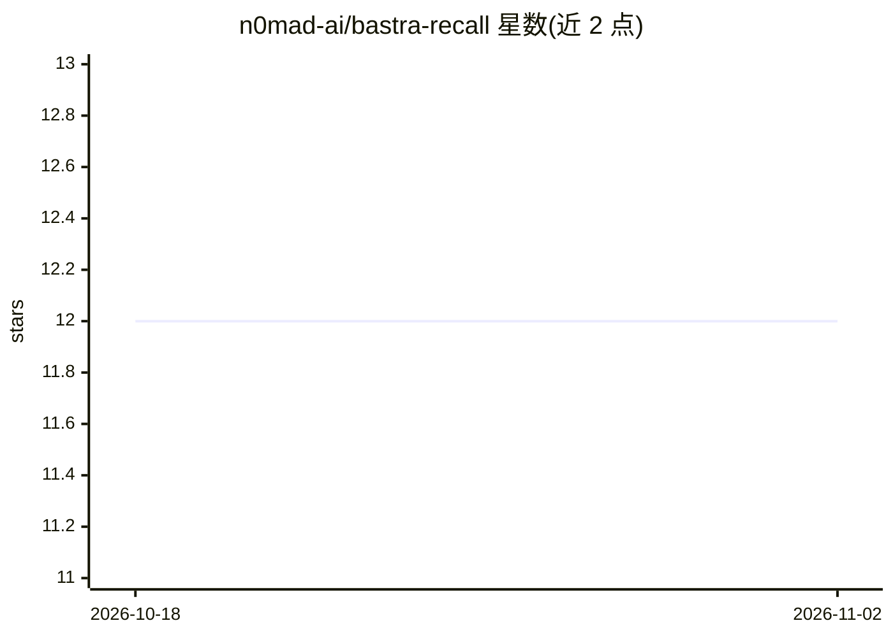

# n0mad-ai/bastra-recall

⭐ 12 · TypeScript · MIT · 推送 2026-10-31 · [GitHub](https://github.com/n0mad-ai/bastra-recall) · [官网](https://bastra.io) · 组织维护

**面向 AI 编码助手的本地优先持久记忆，Markdown 存储**

为 Claude Code、Claude Desktop、Codex、Cursor 等 MCP 客户端提供共享记忆服务：偏好、决策与经验以可读 Markdown 文件存储在本机，各工具共用同一 vault，通过 hooks 在会话开始与操作前注入相关记忆。支持 MCP、REST API、远程 MCP（OAuth）、本地关键词检索，可选 Ollama 本地语义检索或 OpenAI 嵌入。提供 bastra doctor 诊断、vault 地图浏览、实验性代码感知（Graphify 本地代码图）。macOS/Linux 支持，Windows 仅为实验性准备；多设备同步需自行依赖 iCloud 等服务。

## 筛选速览

| 维度 | 判定 | 备注 |
|---|---|---|
| AI 角色 | `ai-ecosystem` | LLM/agent 周边工具 |
| 许可风险 | `permissive` | MIT |
| 部署形态 | `desktop` | 安装包/桌面程序 |
| 模型依赖 | local-ok | 支持本地模型 |
| 硬件要求 | — | 无带数字的原话,不猜 |
| 安装摩擦 | `low` | 无编译、无系统依赖或容器化 |
| 成熟度 | — | 结构信号不足 |

## 能力要点

- 记忆以本地 Markdown 文件存储，可用任意编辑器/Obsidian 检查修改
- 多 AI 客户端（Claude Code/Codex/Cursor 等）共享同一记忆 vault
- 关键词检索为默认，可选本地 Ollama 语义检索与 doc2query 触发词扩展
- 实验性代码感知：本地构建代码图，标注文件依赖关系（默认关闭）

## 适用场景

- 跨会话、跨工具保留项目偏好与决策，替代不断膨胀的 CLAUDE.md
- 让 Claude Code 与 Codex 共用一套项目经验，避免各自维护规则文件
- 在本地掌控 AI 记忆文件并人工审阅修正

## 场景标签

`Agent 记忆` · 领域:Agent 开发

## 证据(README 行号)

> L18: Keep your preferences, decisions and hard-won fixes available beyond a single chat. Bastra Recall stores them as re
> L34: - **One memory for several tools:** Claude Code, Codex and other MCP-capable tools share the same vault, so you don
> L93: Other MCP clients can connect through the forwarder, or remotely over `/api/v1/mcp`, but are untested. Scripts and 

## 星数曲线

2026-10-18 12 → 2026-11-02 12（+0）

---
*卡片 v1 · prompt 1.4 · 生成 2026-11-01 · 置信度 mid · 依据 README sha `153c6de1c2ce` · [字段定义](../../DATASET.md)*
