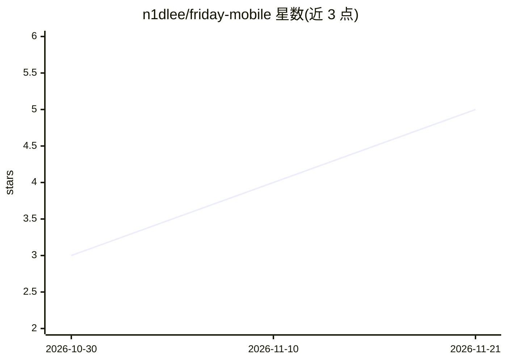

# n1dlee/friday-mobile

⭐ 5 · Kotlin · NOASSERTION · 推送 2026-11-02 · [GitHub](https://github.com/n1dlee/friday-mobile) · 个人维护

**Android 离线唤醒+声纹验证的语音助手，LLM Agent 操作手机**

Kotlin/Compose 编写的 Android 免持语音助手：离线 Vosk 关键词唤醒，ResNet34 声纹校验仅响应机主语音；约 40 条日常命令本地执行，其余交给带 24 个工具的 LLM Agent（Groq 托管），学过的短语后续绕过模型。覆盖闹钟、通话、消息、音乐、设置、日历、天气、语音创建模式等，聊天经通知读取与回复。需免费 Groq API key、64 位 Android 8.0+ 手机，界面与语音支持俄语和英语，以 Release APK 安装或源码构建。

## 筛选速览

| 维度 | 判定 | 备注 |
|---|---|---|
| AI 角色 | `ai-native` | 本体是模型或模型工具 |
| 许可风险 | `permissive` | NOASSERTION |
| 部署形态 | `None` |  |
| 模型依赖 | locked-api |  |
| 硬件要求 | — | 无带数字的原话,不猜 |
| 安装摩擦 | `medium` | 含编译或系统依赖之一 |
| 成熟度 | `idea` | |

## 能力要点

- 离线关键词唤醒 + ResNet34 声纹验证，唤醒前音频不出手机
- 两级架构：本地命令优先，LLM Agent（24 工具）兜底，学到的短语跳过模型
- 经通知读取并回复 WhatsApp/Telegram/SMS 聊天，长聊天摘要
- 语音创建可定时、可绑定 NFC/蓝牙/充电触发的自定义模式

## 适用场景

- 在 Android 手机上免持操作闹钟、通话、消息和音乐
- 用语音回复收到的 WhatsApp/Telegram 聊天
- 按国家、运营商和常用应用自动选择短信或 WhatsApp 发送方式
- 创建带自动撤销和定时执行的语音模式（如休息模式、驾驶模式）

## 场景标签

`AI 助手` `语音 Agent` · 领域:对话与助手

## 证据(README 行号)

> L20: Friday is a hands-free personal assistant for Android in the spirit of J.A.R.V.I.S. and F.R.I.D.A.Y. from Iron Man.
> L37: ### ⚡ Two-tier brain
> L38: About 40 everyday commands run straight on the phone in milliseconds. Everything else goes to an LLM agent with **2

## 星数曲线

2026-10-30 3 → 2026-11-21 5（+2）

---
*卡片 v1 · prompt 1.4 · 生成 2026-11-21 · 置信度 high · 依据 README sha `8c591b8b580e` · [字段定义](../../DATASET.md)*
