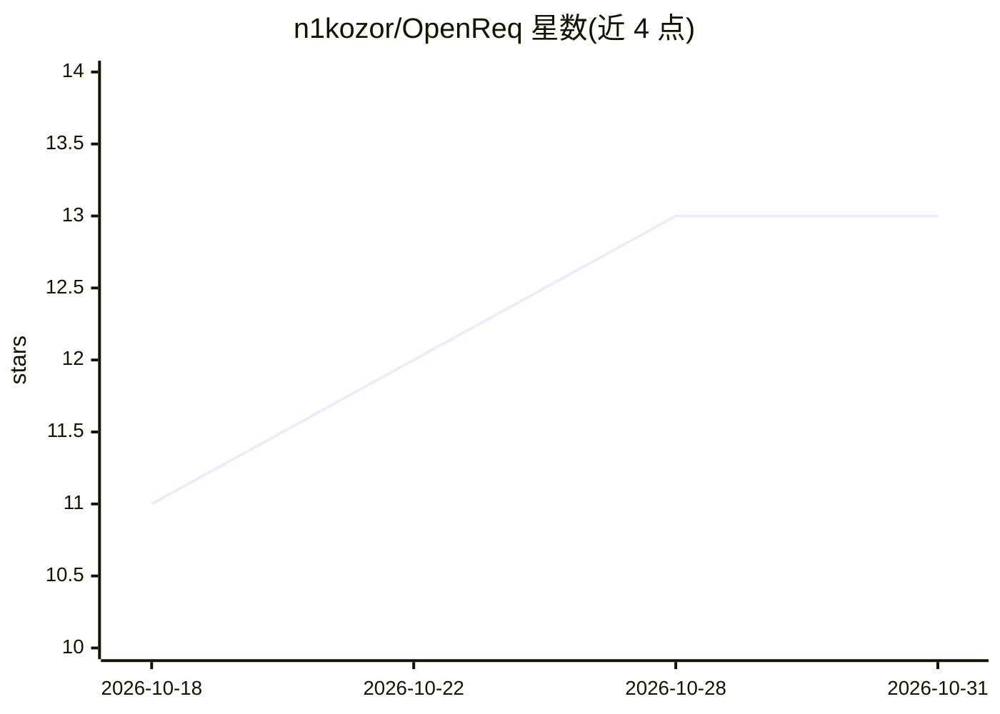

# n1kozor/OpenReq

⭐ 13 · TypeScript · MIT · 推送 2026-04-28 · [GitHub](https://github.com/n1kozor/OpenReq) · [官网](https://openreq.app) · 个人维护

**开源 HTTP API 测试调试客户端，带 AI 辅助集合导入**

用于测试、调试与文档化 HTTP API 的开源客户端，功能包括请求构建、认证、脚本、环境、代码生成、可视化测试流程，支持 WebSocket 与 GraphQL，可从 Postman/OpenAPI/cURL 导入并导出到 Postman。提供三种形态：Standalone 桌面版（内嵌后端、本地 SQLite、无需服务器）、Desktop Client（连接自托管后端）、自托管 Web 版。AI 能力为 AI 辅助集合导入一项，属于产品内的辅助功能。技术栈为 FastAPI + React，MIT 许可。

## 筛选速览

| 维度 | 判定 | 备注 |
|---|---|---|
| AI 角色 | `ai-enhanced` | 去掉 AI 部分产品仍成立 |
| 许可风险 | `permissive` | MIT |
| 部署形态 | `self-host` | docker 或自建部署 |
| 模型依赖 | — | README 未给出锁定关系 |
| 硬件要求 | — | 无带数字的原话,不猜 |
| 安装摩擦 | `low` | 无编译、无系统依赖或容器化 |
| 成熟度 | — | 结构信号不足 |

## 能力要点

- 请求构建、脚本、环境、代码生成与可视化测试流程
- WebSocket 与 GraphQL 支持
- Postman/OpenAPI/cURL 导入，导出 Postman
- Standalone 桌面版内嵌后端与本地 SQLite，可离线运行

## 适用场景

- 代替手工工具测试与调试 REST/GraphQL/WebSocket 接口
- 把现有 Postman 集合迁移到自托管环境
- 团队通过自托管后端共享工作区

## 场景标签

 · 领域:开发者工具/API 测试

## 证据(README 行号)

> L3: A modern, open-source API client for testing, debugging, and documenting HTTP APIs.
> L11: - AI-assisted collection import

## 星数曲线

2026-10-18 11 → 2026-10-31 13（+2）

---
*卡片 v1 · prompt 1.4 · 生成 2026-10-31 · 置信度 high · 依据 README sha `53a5ea548001` · [字段定义](../../DATASET.md)*
