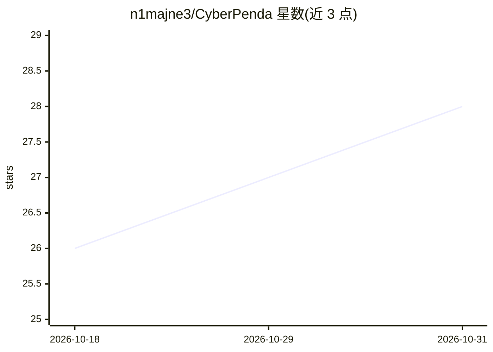

# n1majne3/CyberPenda

⭐ 28 · Go · MIT · 推送 2026-10-26 · [GitHub](https://github.com/n1majne3/CyberPenda) · [官网](https://cyberpenda-demo.vercel.app) · 个人维护 · 中文 README

**本地优先的授权渗透测试 agent 工作台**

面向红队/AppSec 工程师的本地渗透测试 agent 平台：Go 守护进程 pentestd + React 仪表盘 + Codex / Claude Code / Pi 三种运行时插件，项目范围（scope）、审批与宿主运行器激活为一级产品概念。工具在 Docker/Podman 沙箱运行器内执行而非经守护进程代理；以 Goal/Step/Fact Blackboard 与持久化 Receipts 组织任务状态，数据默认存本机 SQLite。提供 make dev 源码构建、make build 自包含二进制与 Docker Compose 部署三种方式，沙箱运行需 Linux 容器引擎。

## 筛选速览

| 维度 | 判定 | 备注 |
|---|---|---|
| AI 角色 | `ai-native` | 本体是模型或模型工具 |
| 许可风险 | `permissive` | MIT |
| 部署形态 | `desktop` | 安装包/桌面程序 |
| 模型依赖 | — | README 未给出锁定关系 |
| 硬件要求 | — | 无带数字的原话,不猜 |
| 安装摩擦 | `low` | 无编译、无系统依赖或容器化 |
| 成熟度 | — | 结构信号不足 |

## 能力要点

- Go 守护进程 + React 仪表盘 + Codex/Claude Code/Pi 三种运行时插件
- 工具在 Docker/Podman 沙箱运行器内执行，宿主运行器需显式启用
- Goal/Step/Fact Blackboard 与持久化 Receipts 状态管理
- 支持 openai_responses / anthropic_messages / openai_chat_completions 模型协议接入

## 适用场景

- 在授权测试中以本地 agent 工作台管理带范围与审批的渗透测试会话
- 团队在自有机器上以多种 agent 运行时执行红队任务并保留发现记录
- 通过 Docker Compose 一键部署本地渗透测试 agent 环境

## 场景标签

`网络安全` · 领域:学习与行业

## 证据(README 行号)

> L5: **Local-first pentest agent** for **authorized** testing: a Go control plane, React dashboard, and Codex / Claude Co
> L27: - Red team / AppSec engineers who want an **on-machine** agent workspace with durable findings
> L44: |`pentestd`|Local HTTP daemon: SQLite store, Runtime Harness, FGS receiver, embedded UI|

## 星数曲线

2026-10-18 26 → 2026-10-31 28（+2）

---
*卡片 v1 · prompt 1.4 · 生成 2026-10-26 · 置信度 high · 依据 README sha `970b52bf10a3` · [字段定义](../../DATASET.md)*
