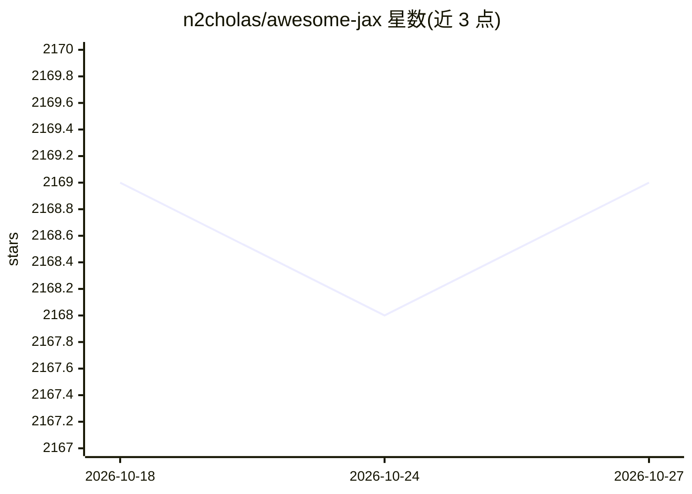

# n2cholas/awesome-jax

⭐ 2,169 · CC0-1.0 · 推送 2026-01-20 · [GitHub](https://github.com/n2cholas/awesome-jax) · 个人维护

**JAX 生态资源策展清单：收录库、模型实现与项目**

由个人维护的 JAX 生态 curated list，收录上百个基于 JAX/Flax 的库与项目条目：神经网络库（Flax、Haiku、Equinox 等）、概率编程、强化学习、可微物理仿真、科学计算等类别，并单列论文官方实现与模型项目（NeRF、DeepSeek-R1-Flax 蒸馏版等）。另设 New Libraries 区收录尚未经大规模使用验证的库，README 中有对应提示。面向使用 JAX 做机器学习研究的开发者。

## 筛选速览

| 维度 | 判定 | 备注 |
|---|---|---|
| AI 角色 | `ai-knowledge` | 知识聚合/清单类 |
| 许可风险 | `viral` | CC0-1.0 |
| 部署形态 | `None` |  |
| 模型依赖 | — | README 未给出锁定关系 |
| 硬件要求 | — | 无带数字的原话,不猜 |
| 安装摩擦 | `medium` | 含编译或系统依赖之一 |
| 成熟度 | — | 结构信号不足 |

## 能力要点

- 按类别组织上百个 JAX 库条目（神经网络/概率编程/RL/可微仿真等）
- 单列论文官方实现与 Flax 模型项目
- New Libraries 区收录未大规模验证的库并有说明

## 适用场景

- 为 JAX 项目选型查找可用的库
- 按领域（RL、概率编程、科学计算）发现 JAX 工具
- 查找论文对应的 JAX/Flax 官方实现

## 场景标签

`精选清单` · 领域:学习与行业

## 证据(README 行号)

> L3: JAX brings automatic differentiation and the XLA compiler together through a NumPy-like API for high performance mac
> L5: This is a curated list of awesome JAX libraries, projects, and other resources. Contributions are welcome!

## 星数曲线

2026-10-18 2,169 → 2026-10-27 2,169（+0）

---
*卡片 v1 · prompt 1.4 · 生成 2026-10-21 · 置信度 high · 依据 README sha `7b8c92ae79a2` · [字段定义](../../DATASET.md)*
