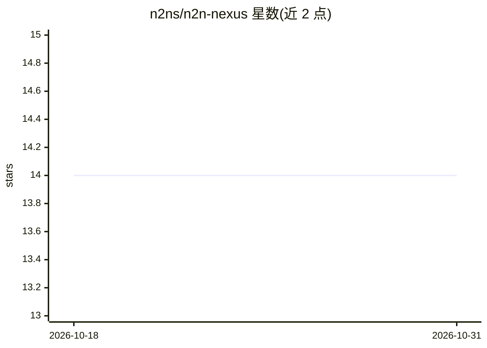

# n2ns/n2n-nexus

⭐ 14 · Go · Apache-2.0 · 推送 2026-10-29 · [GitHub](https://github.com/n2ns/n2n-nexus) · [官网](https://n2ns.com/projects/n2n-nexus) · 组织维护 · 中文 README

**本地优先的 MCP 协调中枢：让多个 AI 助手共享项目状态**

面向跨 IDE、跨机器使用多个 AI 编码助手的开发者与团队：一个常驻本地守护进程 n2n-nexus-host 持有项目状态、会议、消息、任务、共享文档与资产，各 IDE 通过 npm 包中的无状态 MCP 适配器经 HTTP 连接到同一 host。提供 36 个 MCP 工具，覆盖项目注册、助手间直接消息、会议共识、任务追踪与全局文档。数据存于本地 SQLite，默认监听 127.0.0.1，支持按设置的数据保留期清理；明确不支持云端团队聊天、语义代码索引与向量检索。

## 筛选速览

| 维度 | 判定 | 备注 |
|---|---|---|
| AI 角色 | `ai-ecosystem` | LLM/agent 周边工具 |
| 许可风险 | `permissive` | Apache-2.0 |
| 部署形态 | `library` | 以包/库形式分发 |
| 模型依赖 | — | README 未给出锁定关系 |
| 硬件要求 | — | 无带数字的原话,不猜 |
| 安装摩擦 | `low` | 无编译、无系统依赖或容器化 |
| 成熟度 | — | 结构信号不足 |

## 能力要点

- 单一 host 多助手共享：项目清单、会议、消息、任务、文档与资产
- 36 个 MCP 工具，覆盖消息传递、会议共识、任务与项目元数据管理
- 助手会话间直接消息与会议机制，用户持有决策席位
- 本地 SQLite 存储，适配器经 NEXUS_ENDPOINT 跨 Windows/WSL/SSH 连接

## 适用场景

- 多个 AI 编码助手在同一项目上协同与交接
- 跨 IDE、跨机器共享项目决策、会议记录与任务
- 让不同助手会话之间直接传递消息并异步调试

## 场景标签

`多智能体` `Agent 记忆` · 领域:Agent 开发

## 证据(README 行号)

> L17: n2n-nexus is an open-source Model Context Protocol (MCP) coordination server for developers and teams who use multi
> L39: n2n-nexus gives AI assistants a shared coordination workspace. A long-running local host, `n2n-nexus-host`, owns pr
> L44: - **Protocol**: Model Context Protocol (MCP); the adapters reach the host over HTTP

## 星数曲线

2026-10-18 14 → 2026-10-31 14（+0）

---
*卡片 v1 · prompt 1.4 · 生成 2026-10-31 · 置信度 high · 依据 README sha `de7cf92835c2` · [字段定义](../../DATASET.md)*
