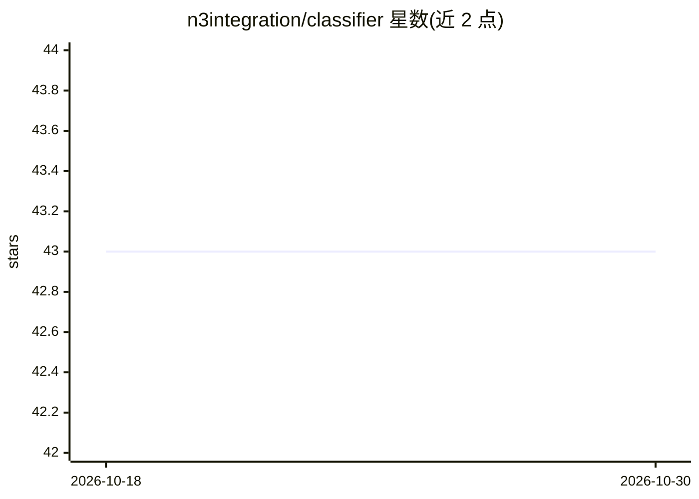

# n3integration/classifier

⭐ 43 · Go · Apache-2.0 · 推送 2026-03-11 · [GitHub](https://github.com/n3integration/classifier) · 个人维护

**Go 通用文本分类库（naïve bayes、kNN）**

Go 语言通用文本分类库，提供 naïve bayes 与 k-nearest neighbors 两种算法。支持两种输入方式：对字符串使用 TrainString/ClassifyString，对较大数据源使用接受 io.Reader 的 Train/Classify。通过 go get 安装，以库形式嵌入 Go 程序使用，需用户自行提供训练数据，README 未提供预训练模型。

## 筛选速览

| 维度 | 判定 | 备注 |
|---|---|---|
| AI 角色 | `ai-native` | 本体是模型或模型工具 |
| 许可风险 | `permissive` | Apache-2.0 |
| 部署形态 | `None` |  |
| 模型依赖 | — | README 未给出锁定关系 |
| 硬件要求 | — | 无带数字的原话,不猜 |
| 安装摩擦 | `low` | 无编译、无系统依赖或容器化 |
| 成熟度 | — | 结构信号不足 |

## 能力要点

- 支持 naïve bayes 与 k-nearest neighbors 两种分类算法
- 提供 string 与 io.Reader 两套训练/分类接口
- 以 Go 包形式通过 go get 安装

## 适用场景

- 在 Go 程序中集成文本分类功能
- 对文档或数据流按自定义类别做自动分类

## 场景标签

 · 领域:机器学习/NLP

## 证据(README 行号)

> L2: General purpose text classifier (naïve bayes, k-nearest neighbors)
> L18: There are two methods of classifying text data: `io.Reader` or `string`. To classify strings, use the `TrainString`

## 星数曲线

2026-10-18 43 → 2026-10-30 43（+0）

---
*卡片 v1 · prompt 1.4 · 生成 2026-10-25 · 置信度 high · 依据 README sha `0cabf1ca8c4d` · [字段定义](../../DATASET.md)*
