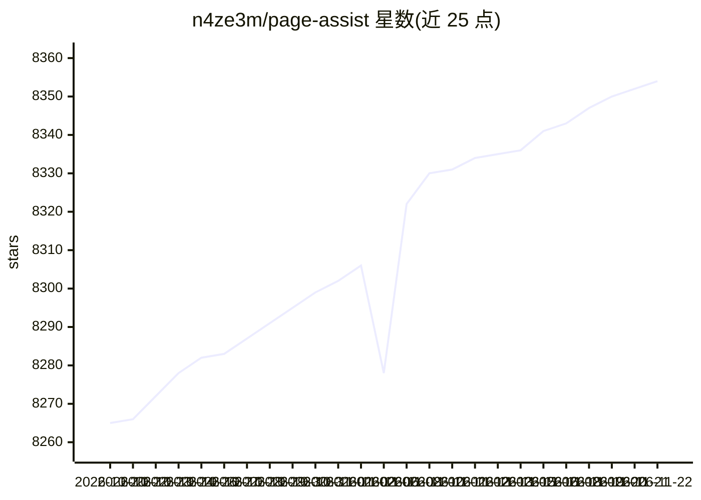

# n4ze3m/page-assist

⭐ 8,354 · TypeScript · MIT · 推送 2026-11-21 · [GitHub](https://github.com/n4ze3m/page-assist) · [官网](https://chromewebstore.google.com/detail/page-assist-a-web-ui-for/jfgfiigpkhlkbnfnbobbkinehhfdhndo) · 个人维护

**连接本地 AI 模型的浏览器扩展：侧边栏与网页 UI 对话**

开源浏览器扩展，为本地运行的 AI 模型提供侧边栏和 Web UI，可在任意网页上与模型交互，并支持与当前网页内容对话。支持 Chromium 系浏览器与 Firefox，官方渠道提供 Chrome/Firefox/Edge 商店安装包，也可用 Bun 从源码构建加载。本地 AI 提供方包括 Ollama、Chrome AI（Gemini Nano）及任何 OpenAI API 兼容端点。声明不收集个人数据，数据存储在浏览器本地，仅分享功能会与服务器通信且可关闭。

## 筛选速览

| 维度 | 判定 | 备注 |
|---|---|---|
| AI 角色 | `ai-native` | 本体是模型或模型工具 |
| 许可风险 | `permissive` | MIT |
| 部署形态 | `None` |  |
| 模型依赖 | local-ok | 支持本地模型 |
| 硬件要求 | — | 无带数字的原话,不猜 |
| 安装摩擦 | `low` | 无编译、无系统依赖或容器化 |
| 成熟度 | — | 结构信号不足 |

## 能力要点

- 任意网页可打开侧边栏与本地模型对话，支持 Chat With Webpage
- 支持 Ollama、Chrome AI（Gemini Nano）与 OpenAI API 兼容端点
- Chrome/Firefox/Edge 商店安装包，另可 Bun 源码构建
- 丰富的可自定义键盘快捷键（侧边栏、Web UI、聊天模式切换）

## 适用场景

- 在浏览网页时随时向本地模型提问
- 针对当前网页内容进行提问与总结
- 用 LM Studio 等 OpenAI 兼容端点作为聊天后端

## 场景标签

`聊天机器人` `文档问答` `AI 助手` · 领域:对话与助手

## 证据(README 行号)

> L9: Page Assist is an open-source browser extension that provides a sidebar and web UI for your local AI model. It allow
> L141: ## Local AI Provider
> L147: - OpenAI API Compatible endpoints (like LM Studio, llamafile etc.)

## 星数曲线

2026-10-20 8,265 → 2026-11-22 8,354（+89）

---
*卡片 v1 · prompt 1.4 · 生成 2026-11-22 · 置信度 high · 依据 README sha `ad5373d575d7` · [字段定义](../../DATASET.md)*
