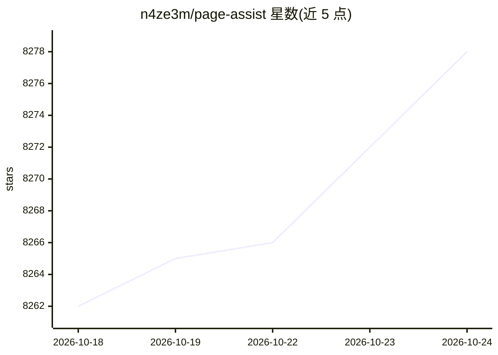

# n4ze3m/page-assist

⭐ 8,278 · TypeScript · MIT · 推送 2026-10-24 · [GitHub](https://github.com/n4ze3m/page-assist) · [官网](https://chromewebstore.google.com/detail/page-assist-a-web-ui-for/jfgfiigpkhlkbnfnbobbkinehhfdhndo) · 个人维护 · 中文 README

**在浏览器中调用本地 AI 模型的开源扩展：侧栏问答与网页对话**

面向本地 AI 模型用户的浏览器扩展，提供可在任意网页打开的侧栏、独立 Web UI 聊天界面，以及针对当前网页内容提问的对话模式。支持 Ollama、Chrome AI（Gemini Nano）及 OpenAI API 兼容端点（LM Studio、llamafile 等）作为本地模型提供方。兼容 Chrome/Brave/Firefox/Edge 等浏览器，可通过应用商店安装或用 Bun 从源码构建。数据存储在浏览器本地，扩展本身不收集个人数据。

## 筛选速览

| 维度 | 判定 | 备注 |
|---|---|---|
| AI 角色 | `ai-native` | 本体是模型或模型工具 |
| 许可风险 | `permissive` | MIT |
| 部署形态 | `None` |  |
| 模型依赖 | local-ok | 支持本地模型 |
| 硬件要求 | — | 无带数字的原话,不猜 |
| 安装摩擦 | `low` | 无编译、无系统依赖或容器化 |
| 成熟度 | — | 结构信号不足 |

## 能力要点

- 任意网页可打开的侧栏与类 ChatGPT 的 Web UI
- 与当前网页内容对话问答
- 支持 Ollama、Chrome AI（Gemini Nano）及 OpenAI API 兼容端点
- 数据本地存储，不收集个人数据

## 适用场景

- 浏览网页时随时向本地模型提问
- 在浏览器里用本地模型替代在线聊天服务
- 针对当前页面内容做问答与总结式提问

## 场景标签

`聊天机器人` `文档问答` · 领域:对话与助手

## 证据(README 行号)

> L9: Page Assist is an open-source browser extension that provides a sidebar and web UI for your local AI model. It allow
> L143: - Ollama

## 星数曲线

2026-10-18 8,262 → 2026-10-24 8,278（+16）

---
*卡片 v1 · prompt 1.4 · 生成 2026-10-20 · 置信度 high · 依据 README sha `c7d8369c72ae` · [字段定义](../../DATASET.md)*
