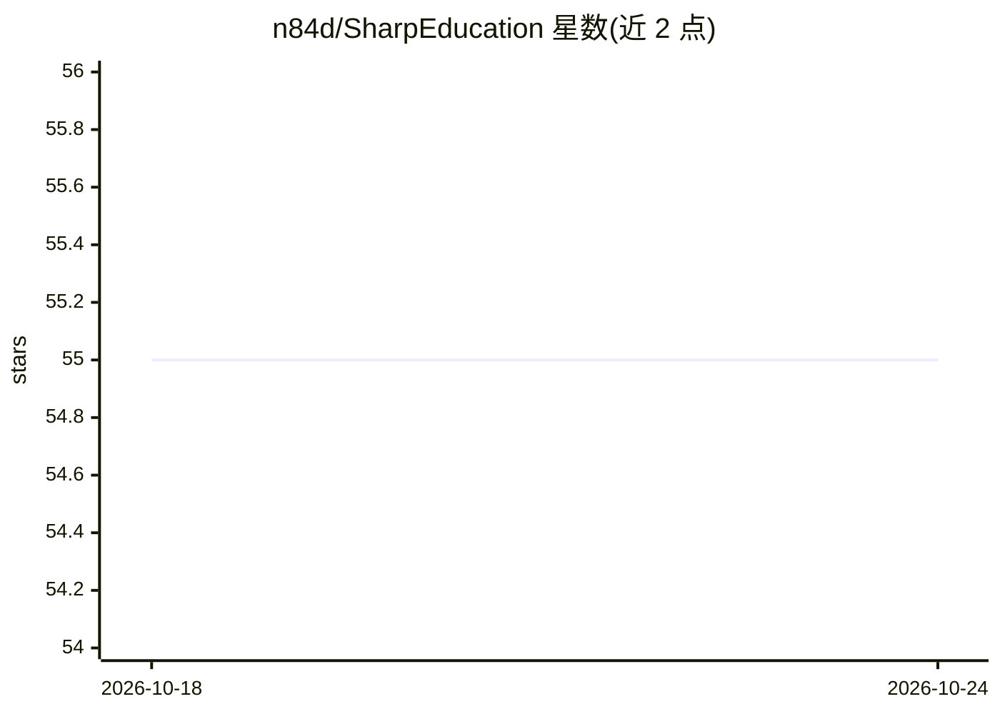

# n84d/SharpEducation

⭐ 55 · Jupyter Notebook · 推送 2026-10-20 · [GitHub](https://github.com/n84d/SharpEducation) · [官网](https://sharpresearch.ai/education) · 组织维护

**Python 交易策略教学笔记本集，配合 YouTube 频道使用**

Sharp Research YouTube 频道配套的教学仓库，以 Jupyter 笔记本形式演示如何用 Python 构建与测试完整交易策略，内容覆盖移动平均、MACD/RSI/MFI 等技术指标、线性与逻辑回归、机器学习训练测试拆分与过拟合、FRED 利率数据策略及风险回报等进阶概念。使用方式为克隆仓库、创建虚拟环境并安装 requirements.txt 依赖，打开任意笔记本调整顶部全局变量即可测试不同策略与参数。要求 Python 3.8+。

## 筛选速览

| 维度 | 判定 | 备注 |
|---|---|---|
| AI 角色 | `ai-knowledge` | 知识聚合/清单类 |
| 许可风险 | `none` | — |
| 部署形态 | `library` | 以包/库形式分发 |
| 模型依赖 | — | README 未给出锁定关系 |
| 硬件要求 | — | 无带数字的原话,不猜 |
| 安装摩擦 | `low` | 无编译、无系统依赖或容器化 |
| 成熟度 | — | 结构信号不足 |

## 能力要点

- 按主题分 7 个目录组织笔记本（入门/TA/回归/逻辑回归/ML/经济/进阶）
- 覆盖 MACD、RSI、MFI、布林带等技术指标的实现
- 包含训练/测试拆分与过拟合等机器学习基础内容
- 使用 FRED 利率数据构建策略

## 适用场景

- 跟随 YouTube 教程逐步学习 Python 交易策略构建
- 通过调整笔记本全局变量测试不同策略参数
- 学习回归与机器学习方法在经济数据上的应用

## 场景标签

`金融量化` `教程课程` · 领域:学习与行业

## 证据(README 行号)

> L3: Educational notebooks for the Sharp Research YouTube channel — covering technical analysis, regression, logistic reg
> L40: |`ML/`|Train/test splits and overfitting|

## 星数曲线

2026-10-18 55 → 2026-10-24 55（+0）

---
*卡片 v1 · prompt 1.4 · 生成 2026-10-24 · 置信度 mid · 依据 README sha `6cab87613826` · [字段定义](../../DATASET.md)*
