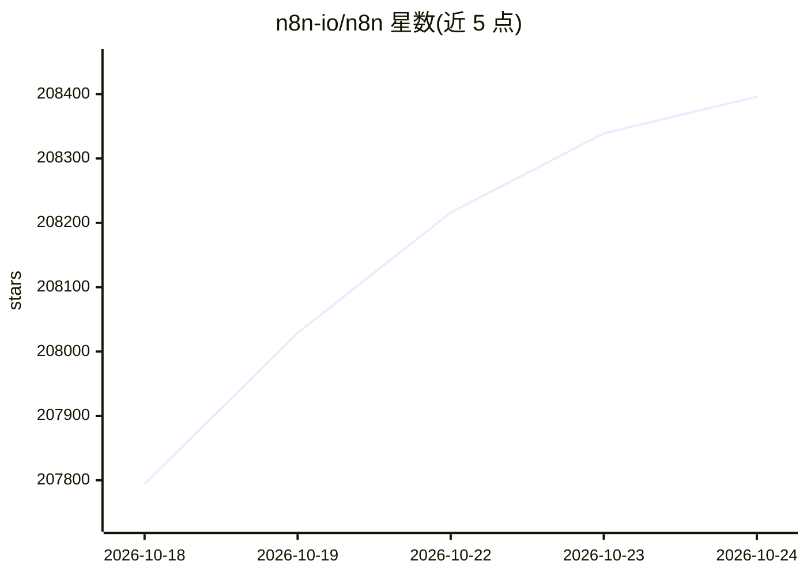

# n8n-io/n8n

⭐ 208,396 · TypeScript · NOASSERTION · 推送 2026-10-23 · [GitHub](https://github.com/n8n-io/n8n) · [官网](https://n8n.io) · 组织维护

**AI 工作流自动化平台：可视化编排 agents 与 1500+ 集成**

Fair-code 工作流自动化平台，用于构建和部署 AI agents 与多步工作流：可视化画布结合 JavaScript/Python 自定义代码与 npm 包，支持自托管或云部署。内置模型灵活性，可接入 OpenAI、Anthropic、Google 或开源模型并切换而不改架构；工作流支持逻辑分支、工具调用、人工审批与可观测性。提供基于角色的访问控制、审计日志与敏感数据处理能力，附带 1500+ 集成和 9000+ 工作流模板。采用 Sustainable Use License 与企业许可分发。

## 筛选速览

| 维度 | 判定 | 备注 |
|---|---|---|
| AI 角色 | `ai-native` | 本体是模型或模型工具 |
| 许可风险 | `dual` | NOASSERTION |
| 部署形态 | `self-host` | docker 或自建部署 |
| 模型依赖 | — | README 未给出锁定关系 |
| 硬件要求 | — | 无带数字的原话,不猜 |
| 安装摩擦 | `low` | 无编译、无系统依赖或容器化 |
| 成熟度 | — | 结构信号不足 |

## 动量与使用信号

- 维护:`active` — 距上次 push 0.7 天,年发版 100,431 位贡献者
- 涨星:近 1 天 **+208**(自 20261016 起算)

## 能力要点

- 可视化画布与 JavaScript/Python 代码及 npm 包结合构建 AI 工作流
- 可接入 OpenAI、Anthropic、Google 或开源模型，切换不改架构
- 1500+ 集成与 9000+ 工作流模板
- 支持自托管/云部署、角色权限、审计日志

## 适用场景

- 搭建多步 AI agent 工作流并投入生产
- 连接企业现有系统与 AI 模型做自动化
- 在私有环境自托管处理敏感数据的自动化流程

## 场景标签

`工作流自动化` · 领域:效率与自动化

## 证据(README 行号)

> L11: - **AI-Native Automation Platform**: Build and operationalize AI workflows and multi-step agents using your own dat
> L12: - **Model Flexibility, No Lock-In**: Connect to OpenAI, Anthropic, Google, or open-source models and switch provide

## 星数曲线

2026-10-18 207,794 → 2026-10-24 208,396（+602）

---
*卡片 v1 · prompt 1.4 · 生成 2026-10-18 · 置信度 high · 依据 README sha `6e16f5263757` · [字段定义](../../DATASET.md)*
