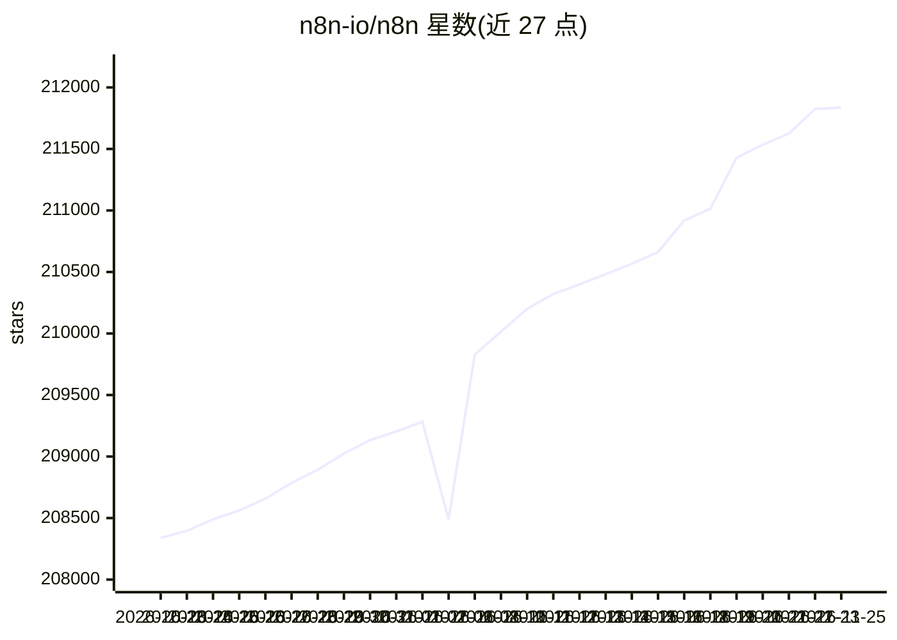

# n8n-io/n8n

⭐ 211,837 · TypeScript · NOASSERTION · 推送 2026-11-24 · [GitHub](https://github.com/n8n-io/n8n) · [官网](https://n8n.io) · 组织维护

**给开发/运维团队的 AI Agent 与工作流自动化平台**

n8n 是一个 fair-code 的工作流自动化平台，用户通过可视化画布结合 JavaScript/Python 代码构建多步骤 AI agent 与自动化流程，可自托管或使用云服务。平台提供 1500+ 集成与 9000+ 工作流模板，支持接入 OpenAI、Anthropic、Google 或开源模型并可切换，内置人工审批、可观测性、基于角色的访问控制与审计日志。通过 Docker 安装脚本或手动 docker run 部署，编辑器默认运行在 5678 端口。

## 筛选速览

| 维度 | 判定 | 备注 |
|---|---|---|
| AI 角色 | `ai-ecosystem` | LLM/agent 周边工具 |
| 许可风险 | `none` | NOASSERTION |
| 部署形态 | `self-host` | docker 或自建部署 |
| 模型依赖 | — | README 未给出锁定关系 |
| 硬件要求 | — | 无带数字的原话,不猜 |
| 安装摩擦 | `low` | 无编译、无系统依赖或容器化 |
| 成熟度 | — | 结构信号不足 |

## 动量与使用信号

- 维护:`active` — 距上次 push 0.7 天,年发版 100,431 位贡献者
- 涨星:近 1 天 **+208**(自 20261016 起算)

## 能力要点

- 可视化画布结合 JavaScript/Python/npm 包构建 AI 工作流
- 模型灵活接入：OpenAI/Anthropic/Google/开源模型可切换
- 1500+ 集成与 9000+ 工作流模板
- 支持自托管，含角色访问控制与审计日志

## 适用场景

- 把内部系统与 AI 模型串成多步骤自动化流程
- 自托管部署带审批与审计的 AI agent 生产环境
- 基于现成模板快速搭建集成工作流

## 场景标签

`工作流自动化` `Agent 框架` · 领域:Agent 开发

## 证据(README 行号)

> L3: # n8n – The Platform for AI Agents and Workflow Automation
> L11: - **AI-Native Automation Platform**: Build and operationalize AI workflows and multi-step agents using your own dat
> L14: - **Code When You Need It**: Combine visual building with JavaScript, Python, and npm packages for advanced AI work

## 星数曲线

2026-10-23 208,339 → 2026-11-25 211,837（+3,498）

---
*卡片 v1 · prompt 1.4 · 生成 2026-11-22 · 置信度 high · 依据 README sha `57e6c976bc1e` · [字段定义](../../DATASET.md)*
