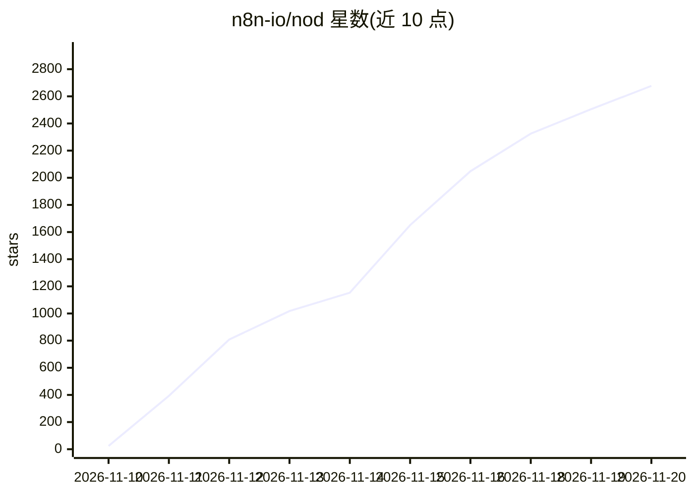

# n8n-io/nod

⭐ 2,677 · TypeScript · Apache-2.0 · 推送 2026-11-19 · [GitHub](https://github.com/n8n-io/nod) · [官网](https://nod.n8n.io/) · 组织维护

**开源个人 AI agent：自带计算机替用户完成网页杂务**

n8n 团队开发的开源桌面个人 agent，配备专属虚拟计算机与浏览器，跨 Gmail、Calendar、Slack、Notion 与真实网站执行任务：追讨发票、生成通话简报、草拟 Slack 回复、定时监控页面变化。支持用户自选模型（OpenAI/Anthropic/Gemini/OpenRouter/Bedrock 等 20+ 提供商或自有服务器），行动前需用户确认，记忆与登录数据留在本机。以 Electron 桌面应用分发，也可从源码运行（需 Node.js 24+、pnpm、Docker）。自我声明为 research preview。

## 筛选速览

| 维度 | 判定 | 备注 |
|---|---|---|
| AI 角色 | `ai-native` | 本体是模型或模型工具 |
| 许可风险 | `permissive` | Apache-2.0 |
| 部署形态 | `None` |  |
| 模型依赖 | locked-api |  |
| 硬件要求 | — | 无带数字的原话,不猜 |
| 安装摩擦 | `low` | 无编译、无系统依赖或容器化 |
| 成熟度 | `idea` | |

## 能力要点

- 自有计算机与浏览器，在真实网站上完成任务
- 支持自选模型提供商 20+ 或自有服务器，含 ChatGPT Plus/Pro 登录
- 服务端信任检查：可变更操作需用户确认，Vault 隔离密码输入
- 本地优先：文件、记忆、登录数据留在本机

## 适用场景

- 让 agent 追讨发票、取消试用订阅等网页杂务
- 每天自动汇总消息与日历生成通话简报
- 按定价表草拟 Slack 回复并在批准后发送

## 场景标签

`浏览器自动化` `AI 助手` · 领域:效率与自动化

## 证据(README 行号)

> L1: n8n presents Nod: open source personal agent with its own computer
> L4:  It chases invoices, preps your calls and cancels trials, on real websites.
> L65: - **Uses the model you choose.** OpenAI, Anthropic, Gemini, OpenRouter, Bedrock, Vertex AI, Azure, 20+ more, or you

## 星数曲线

2026-11-10 24 → 2026-11-20 2,677（+2,653）

---
*卡片 v1 · prompt 1.4 · 生成 2026-11-17 · 置信度 high · 依据 README sha `19de78d5801d` · [字段定义](../../DATASET.md)*
