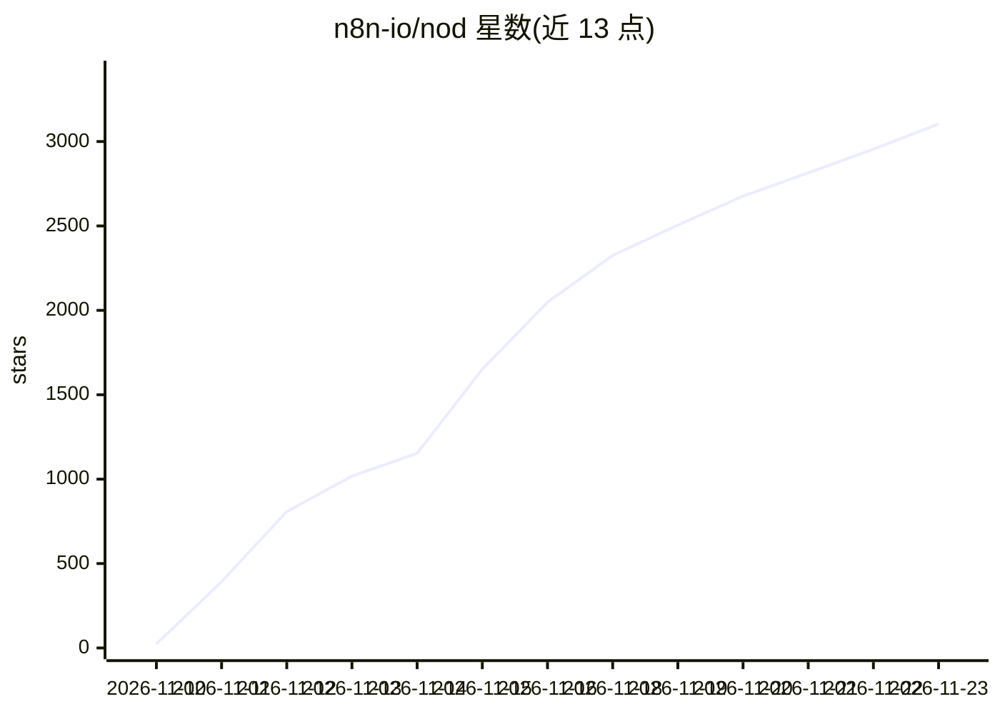

# n8n-io/nod

⭐ 3,104 · TypeScript · Apache-2.0 · 推送 2026-11-22 · [GitHub](https://github.com/n8n-io/nod) · [官网](https://nod.n8n.io/) · 组织维护

**开源自用个人 agent，自带电脑与浏览器替你跑真实网站任务**

n8n 团队推出的开源桌面个人 agent（Electron 应用），在用户本机或自有服务器运行，通过自有浏览器与应用连接执行追讨发票、生成通话简报、草拟 Slack 回复、定时页面监控等任务；每次可能改变状态的操作需用户批准后执行。架构为 Node.js 进程加 Docker 容器，信任检查、密码 Vault 与支出限制置于服务端而非提示词；记忆逐条可见可编辑，风格学习仅来自用户已发邮件。当前为 research preview，需 ChatGPT Plus/Pro 或 API key。

## 筛选速览

| 维度 | 判定 | 备注 |
|---|---|---|
| AI 角色 | `ai-native` | 本体是模型或模型工具 |
| 许可风险 | `permissive` | Apache-2.0 |
| 部署形态 | `None` |  |
| 模型依赖 | locked-api |  |
| 硬件要求 | — | 无带数字的原话,不猜 |
| 安装摩擦 | `low` | 无编译、无系统依赖或容器化 |
| 成熟度 | — | 结构信号不足 |

## 能力要点

- 本地优先：文件、记忆、登录凭据留在本机或自有服务器
- 模型可选：OpenAI、Anthropic、Gemini、OpenRouter、Bedrock、Vertex AI、Azure 等 20+ 提供商或自有服务器
- 服务端信任检查：未覆盖的网站步骤等待用户批准
- 实测指标：226 项任务 98% 完成、678 次运行 0 次不安全操作（模拟环境）

## 适用场景

- 自动追讨发票、取消试用等需要登录网站的多步任务
- 每天早上根据消息与日历自动生成通话简报
- 定时监控页面价格变动并只在变化时通知
- 按我的定价表草拟回复并在我批准后发送

## 场景标签

`浏览器自动化` `AI 助手` · 领域:效率与自动化

## 证据(README 行号)

> L1: n8n presents Nod: open source personal agent with its own computer
> L43:  Jobs that eat an afternoon of tabs, logins, and forms. Nod has its own computer and browser, so it finishes them.
> L100: - **Built with** TypeScript on Node.js 24, Fastify, React, PostgreSQL with pg-boss, the Pi agent runtime, agent-br

## 星数曲线

2026-11-10 24 → 2026-11-23 3,104（+3,080）

---
*卡片 v1 · prompt 1.4 · 生成 2026-11-23 · 置信度 high · 依据 README sha `db32496515f3` · [字段定义](../../DATASET.md)*
