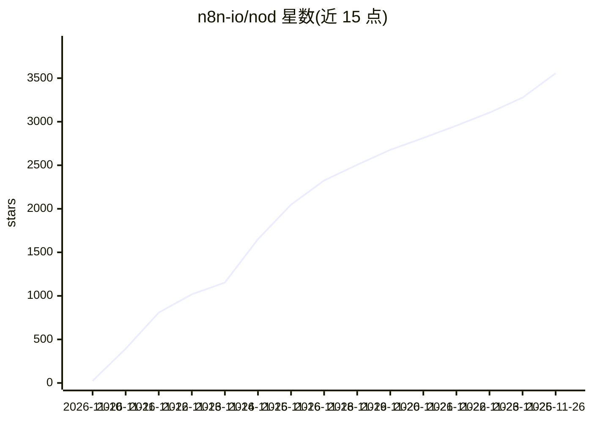

# n8n-io/nod

⭐ 3,556 · TypeScript · Apache-2.0 · 推送 2026-11-25 · [GitHub](https://github.com/n8n-io/nod) · [官网](https://nod.n8n.io/) · 组织维护

**本地运行的个人 AI 代理，代替用户在真实网站执行任务**

n8n 团队出品的开源个人代理，自带独立计算机与浏览器环境，可跨 Gmail、Calendar、Slack、Notion 及网页执行追账单、准备通话简报、取消试用等任务，并在代替用户操作前先请求确认。运行在用户本机或自有服务器，数据与记忆留存本地；服务器侧执行信任检查，密码由 Vault 私密注入而不进入模型。提供 Mac/Windows 安装包，Linux 为预览版；底层为 Node.js 24 上的 TypeScript 进程加 Docker 容器。当前为 research preview 状态。

## 筛选速览

| 维度 | 判定 | 备注 |
|---|---|---|
| AI 角色 | `ai-native` | 本体是模型或模型工具 |
| 许可风险 | `permissive` | Apache-2.0 |
| 部署形态 | `None` |  |
| 模型依赖 | — | README 未给出锁定关系 |
| 硬件要求 | — | 无带数字的原话,不猜 |
| 安装摩擦 | `low` | 无编译、无系统依赖或容器化 |
| 成熟度 | `idea` | |

## 能力要点

- 自带浏览器与计算机环境，在真实网站完成任务并支持浏览器自动化
- 动作经信任检查，未被规则覆盖的操作需用户确认后执行
- 本地记忆系统：偏好、写作风格、任务步骤均可记忆并可见可编辑
- 支持 OpenAI、Anthropic、Gemini、OpenRouter、Bedrock 等 20+ 模型来源或自有服务器

## 适用场景

- 每天早上自动生成一页通话简报
- 起草 Slack/邮件回复并在批准后发送
- 定时监测页面价格变动并报告
- 代替用户在网站上完成登录、表单等多步任务

## 场景标签

`浏览器自动化` `GUI 自动化` `AI 助手` · 领域:效率与自动化

## 证据(README 行号)

> L4:  It chases invoices, preps your calls and cancels trials, on real websites.
> L79: - **Uses the model you choose.** OpenAI, Anthropic, Gemini, OpenRouter, Bedrock, Vertex AI, Azure, 20+ more, or you

## 星数曲线

2026-11-10 24 → 2026-11-26 3,556（+3,532）

---
*卡片 v1 · prompt 1.4 · 生成 2026-11-24 · 置信度 high · 依据 README sha `a6a9cd6abbe0` · [字段定义](../../DATASET.md)*
