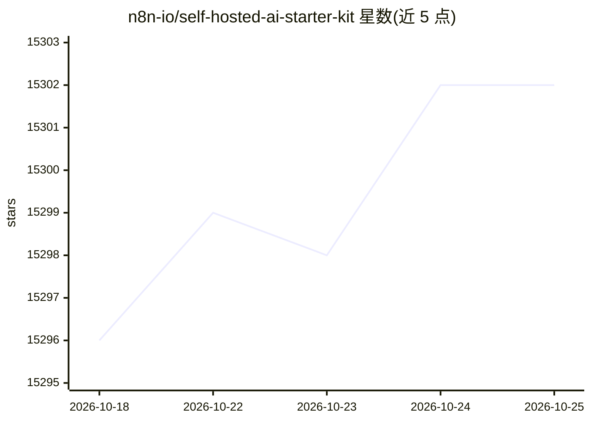

# n8n-io/self-hosted-ai-starter-kit

⭐ 15,302 · Apache-2.0 · 推送 2026-10-12 · [GitHub](https://github.com/n8n-io/self-hosted-ai-starter-kit) · [官网](https://n8n.io) · 组织维护

**自托管本地 AI 工作流入门模板：一条 Docker Compose 拉起整套环境**

由 n8n 官方维护的 Docker Compose 模板，组合四个组件：n8n 低代码平台（400+ 集成与 AI 节点）、Ollama 本地 LLM 运行时、Qdrant 向量库、PostgreSQL。按 GPU 型号（Nvidia/AMD/Apple Silicon/CPU）提供不同 compose profile，一条命令启动；预配置网络与存储，含示例工作流与本地文件共享目录挂载。README 说明面向原型验证，非生产环境优化。

## 筛选速览

| 维度 | 判定 | 备注 |
|---|---|---|
| AI 角色 | `ai-ecosystem` | LLM/agent 周边工具 |
| 许可风险 | `permissive` | Apache-2.0 |
| 部署形态 | `self-host` | docker 或自建部署 |
| 模型依赖 | local-ok | 支持本地模型 |
| 硬件要求 | — | 无带数字的原话,不猜 |
| 安装摩擦 | `low` | 无编译、无系统依赖或容器化 |
| 成熟度 | — | 结构信号不足 |

## 动量与使用信号

- 维护:`active` — 距上次 push 6.0 天,年发版 0,15 位贡献者
- 涨星:近 1 天 **+3**(自 20261016 起算)
- 平台:LINUX · 协议:OLLAMA

## 能力要点

- 一条 docker compose 命令启动 n8n + Ollama + Qdrant + PostgreSQL 组合
- 按 Nvidia GPU / AMD GPU / Mac / CPU 提供不同启动 profile
- 内置示例工作流与 400+ 集成的 n8n 平台
- 本地文件共享目录挂载至 n8n 容器 /data/shared

## 适用场景

- 在本地搭建自托管的 AI 工作流开发环境
- 构建不泄露数据的 PDF 摘要、财务文档分析等私有文档处理流程
- 快速原型化 AI Agent 与 Slack 机器人等自动化场景

## 场景标签

`工作流自动化` `文档问答` · 领域:效率与自动化

## 证据(README 行号)

> L3: **Self-hosted AI Starter Kit** is an open-source Docker Compose template designed to swiftly initialize a comprehens
> L7: Curated by <https://github.com/n8n-io>, it combines the self-hosted n8n
> L115: The core of the Self-hosted AI Starter Kit is a Docker Compose file, pre-configured with network and storage setti

## 星数曲线

2026-10-18 15,296 → 2026-10-25 15,302（+6）

---
*卡片 v1 · prompt 1.4 · 生成 2026-10-18 · 置信度 high · 依据 README sha `706d4634571b` · [字段定义](../../DATASET.md)*
