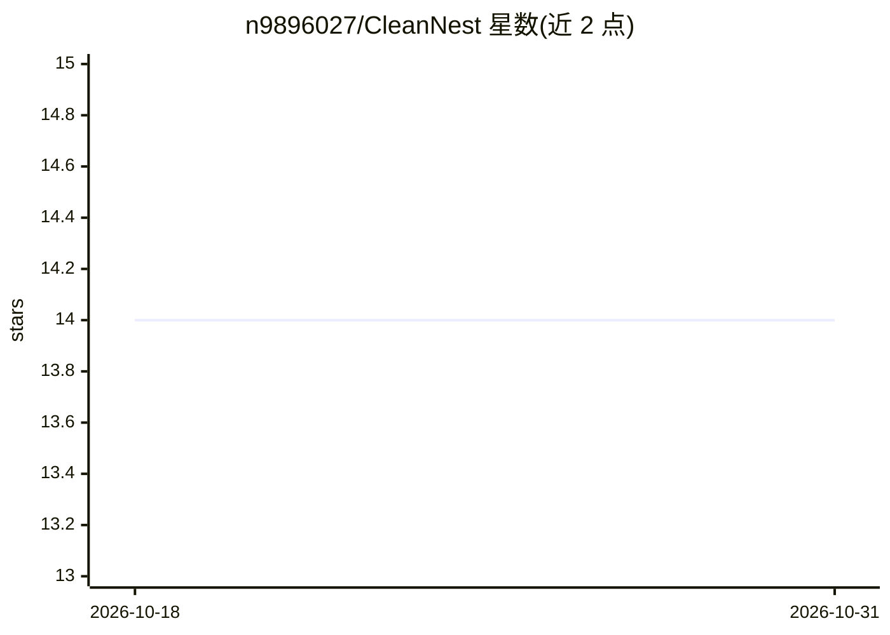

# n9896027/CleanNest

⭐ 14 · Swift · MIT · 推送 2026-08-30 · [GitHub](https://github.com/n9896027/CleanNest) · 个人维护 · 中文 README

**隐私优先的 macOS 原生清理与系统监测工具，可选本机 AI 辅助**

Swift 编写的原生 macOS 图形客户端，功能包括磁盘空间分析、缓存/日志/安装包清理（文件默认移入废纸篓）、App 卸载预览、菜单栏实时系统监测、进程管理、Agent 工作区占用账本与开发工具（Git/Docker/Hugging Face/npm/pip）原生账本，并集成 Mole CLI。AI 为可选功能：连接本机 mlx_lm.server 或 oMLX 回环服务，仅发送脱敏元数据为清理候选补充解释与风险提示；无 AI 时规则扫描仍可运行，AI 建议不能执行删除。当前仅源码开放，尚无经签名的安装包，需用 build.sh 构建。给注重隐私与可撤销操作的 Mac 用户使用。

## 筛选速览

| 维度 | 判定 | 备注 |
|---|---|---|
| AI 角色 | `ai-enhanced` | 去掉 AI 部分产品仍成立 |
| 许可风险 | `permissive` | MIT |
| 部署形态 | `None` |  |
| 模型依赖 | — | README 未给出锁定关系 |
| 硬件要求 | — | 无带数字的原话,不猜 |
| 安装摩擦 | `medium` | 含编译或系统依赖之一 |
| 成熟度 | `idea` | |

## 能力要点

- 清理候选逐项预览确认，文件默认移入 macOS 废纸篓
- 可选本机 MLX/oMLX 模型分析，仅发送脱敏元数据，AI 无法执行删除
- 菜单栏 1-10 秒间隔监测 CPU/内存/网络/GPU/温度/风扇/电池
- 为 Codex、Claude、Kimi 等多种 AI Agent 建立只读占用账本

## 适用场景

- 查看 Mac 磁盘空间占用并安全释放可回收部分
- 清理开发缓存、日志与安装包且操作可撤销
- 用本机模型为清理候选补充用途解释而不上传数据

## 场景标签

 · 领域:系统工具/桌面应用

## 证据(README 行号)

> L90: CleanNest 可以连接本机 `mlx_lm.server`，为清理候选和磁盘目录补充用途解释、风险提示与查看顺序。模型不是清理引擎：规则扫描在没有 AI 时仍可正常工作，AI 失败也不会影响已有结果。
> L98: - AI 只能显示建议，不能扩大扫描范围、改变勾选、关闭进程或执行删除。

## 星数曲线

2026-10-18 14 → 2026-10-31 14（+0）

---
*卡片 v1 · prompt 1.4 · 生成 2026-10-31 · 置信度 high · 依据 README sha `da87b86f525e` · [字段定义](../../DATASET.md)*
