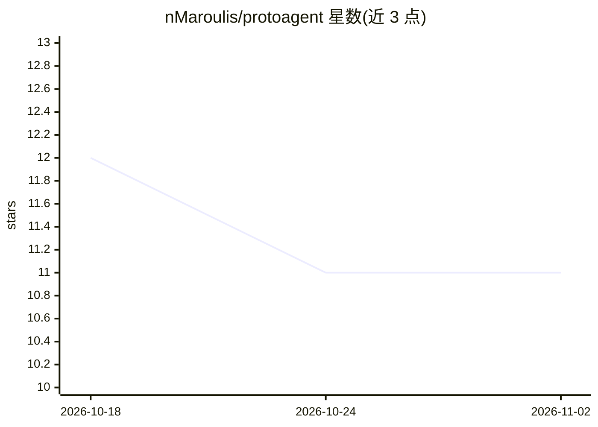

# nMaroulis/protoagent

⭐ 11 · Python · MIT · 推送 2026-10-19 · [GitHub](https://github.com/nMaroulis/protoagent) · [官网](https://nmaroulis.github.io/protoagent/) · 个人维护

**本地优先的编码代理：Rust 终端 UI + Python 核心，面向小模型分工**

由 Rust CLI/TUI 与 Python 核心（基于 ProtoLink 0.8.2 运行时）构成的本地优先编码代理。运行时将小模型分配到窄角色（Architect/Explorer/Coder/Tester/Verifier/Scout），配合 Context Loom 增量索引工作区生成有界的、带来源引用的上下文包，并以 RunContract 做确定性完成检查。Ollama 等支持工具调用的模型走原生工具通道。需要 Python 3.12+、Cargo 1.85+，从源码 clone 后以 cargo run 启动；ACP 编辑器桥接为规划中组件（0.0.0-dev.0）。MIT 许可。

## 筛选速览

| 维度 | 判定 | 备注 |
|---|---|---|
| AI 角色 | `ai-native` | 本体是模型或模型工具 |
| 许可风险 | `permissive` | MIT |
| 部署形态 | `None` |  |
| 模型依赖 | local-ok | 支持本地模型 |
| 硬件要求 | — | 无带数字的原话,不猜 |
| 安装摩擦 | `low` | 无编译、无系统依赖或容器化 |
| 成熟度 | `idea` | |

## 能力要点

- 小模型优先：small/medium/large/api 四档提示词配置文件
- Context Loom 索引工作区并生成有界、带来源引用的上下文包
- 窄角色代理分工（Architect/Explorer/Coder/Tester/Verifier/Scout）
- 写入与恢复需原生审批，含 ask/edits/auto 三种模式

## 适用场景

- 在终端里让多个窄角色代理协作完成代码修改任务
- 本地 Ollama 模型上运行编码代理，控制模型流量不出机器
- 对编辑后的代码自动执行检查通过验证（Verifier）

## 场景标签

`编码 Agent` · 领域:编码与开发

## 证据(README 行号)

> L5: ProtoAgent is a local-first coding agent built around a fast Rust terminal UI
> L33: Ollama models advertising tool support use ProtoLink's native tool channel.

## 星数曲线

2026-10-18 12 → 2026-11-02 11（-1）

---
*卡片 v1 · prompt 1.4 · 生成 2026-11-01 · 置信度 high · 依据 README sha `36f2a1c28f15` · [字段定义](../../DATASET.md)*
