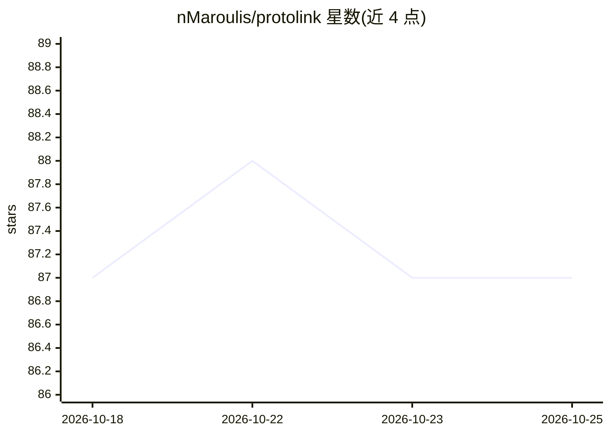

# nMaroulis/protolink

⭐ 87 · Python · MIT · 推送 2026-10-19 · [GitHub](https://github.com/nMaroulis/protolink) · [官网](https://nmaroulis.github.io/protolink/) · 个人维护

**A2A 优先的 Python 多智能体框架，构建可插拔自治 agent**

以 Agent-to-Agent（A2A）协议为核心原语（AgentCard/Task/Message/Part/Artifact，兼容 A2A 1.0 JSON-RPC 形状）构建多智能体系统的 Python 框架，定位为链式框架（如 LangChain）之外的替代路线。每个 Agent 是独立运行时实体，LLM、RAG 知识、MCP 工具、传输（HTTP/gRPC 等）、注册表、存储、遥测、认证均为可插拔可选模块。声明 LLM 无关且本地优先，通过严格 JSON 回退支持 Ollama、llama.cpp、LM Studio、vLLM 等自托管后端。基础包仅依赖 Pydantic，另提供编码 agent 执行、恢复与策略等运行时控制原语。

## 筛选速览

| 维度 | 判定 | 备注 |
|---|---|---|
| AI 角色 | `ai-ecosystem` | LLM/agent 周边工具 |
| 许可风险 | `permissive` | MIT |
| 部署形态 | `library` | 以包/库形式分发 |
| 模型依赖 | local-ok | 支持本地模型 |
| 硬件要求 | — | 无带数字的原话,不猜 |
| 安装摩擦 | `low` | 无编译、无系统依赖或容器化 |
| 成熟度 | — | 结构信号不足 |

## 能力要点

- A2A 协议为架构核心，运行时模型兼容 A2A 1.0 JSON-RPC
- 模块全可插拔：LLM/知识/工具/传输/存储/遥测/认证均可替换
- LLM 无关、本地优先，JSON 回退保持同一推理循环
- 基础包仅一个运行时依赖 Pydantic

## 适用场景

- 构建通过 A2A 协议互相通信的多智能体系统
- 本地小模型驱动 agent，无需绑定特定提供商
- 接入 MCP 服务器工具、RAG 知识库构建应用 agent
- 构建有执行限制与恢复机制的编码/研究助手类 agent

## 场景标签

`Agent 框架` `多智能体` · 领域:Agent 开发

## 证据(README 行号)

> L14: ProtoLink is a lightweight, **A2A**-first Python framework for building **pluggable agents** and multi-agent system
> L20: ProtoLink is deliberately **LLM-agnostic and local-first**. Provider-native tool calling is used when available; a 

## 星数曲线

2026-10-18 87 → 2026-10-25 87（+0）

---
*卡片 v1 · prompt 1.4 · 生成 2026-10-23 · 置信度 high · 依据 README sha `f86ea33a275d` · [字段定义](../../DATASET.md)*
