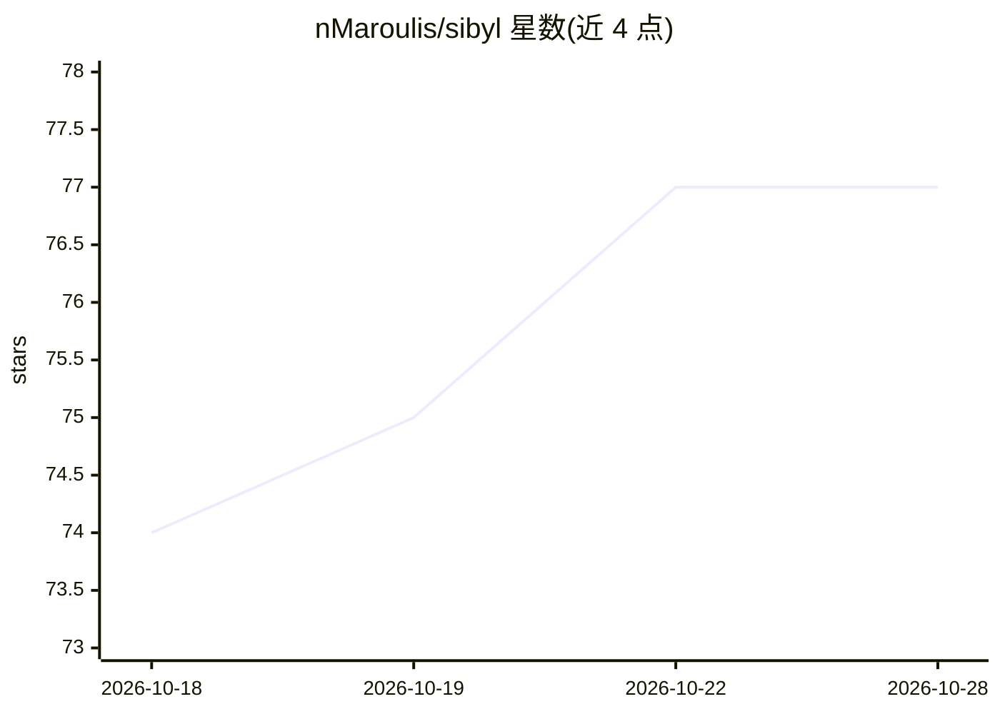

# nMaroulis/sibyl

⭐ 77 · Python · Apache-2.0 · 推送 2026-10-28 · [GitHub](https://github.com/nMaroulis/sibyl) · [官网](https://nmaroulis.github.io/sibyl/index.html) · 个人维护

**本地部署的加密货币交易看板：AI 助手+策略回测+价格预测**

Sibyl 是一个本地部署的加密货币交易综合应用，基于 Streamlit UI 与 FastAPI 后端。功能包括：连接 Binance/Coinbase 等交易所 API 的资产总览（Wallet）；自定义 Python 交易引擎，支持 Bollinger Bands、RSI 等策略与回测（Broker）；基于 TensorFlow Bi-LSTM、GTU、ARIMA 的价格预测（Chronos）；NLP 新闻抓取、摘要与情绪分析（Reporter）；基于 MCP、RAG、chromaDB 的加密百科聊天机器人（Wiki）；以及可在本地或 API 部署 LLM 的 Oracle 上下文感知助手。API 密钥存储于本地加密 SQLite 数据库。提供虚拟环境安装与 Dockerfile 两种部署方式。

## 筛选速览

| 维度 | 判定 | 备注 |
|---|---|---|
| AI 角色 | `ai-native` | 本体是模型或模型工具 |
| 许可风险 | `permissive` | Apache-2.0 |
| 部署形态 | `self-host` | docker 或自建部署 |
| 模型依赖 | — | README 未给出锁定关系 |
| 硬件要求 | — | 无带数字的原话,不猜 |
| 安装摩擦 | `low` | 无编译、无系统依赖或容器化 |
| 成熟度 | — | 结构信号不足 |

## 能力要点

- Oracle：上下文感知 LLM 助手，支持本地 Llama-CPP 或 HuggingFace/OpenAI API 部署
- 自定义交易引擎支持 6 种策略算法与回测（含 sharpe/sortino 等指标）
- TensorFlow Bi-LSTM、GTU、ARIMA 价格预测模型
- Wiki 模块：MCP+RAG+chromaDB，混合 cosine/BM25/FAISS 检索

## 适用场景

- 在一个本地界面里统一管理多交易所账户与交易策略
- 在部署策略前用历史数据回测并查看绩效指标
- 向 AI 助手询问市场情绪、新闻摘要或加密概念
- 用 ML 模型获取加密资产价格预测

## 场景标签

`金融量化` `AI 助手` `聊天机器人` · 领域:对话与助手

## 证据(README 行号)

> L13: # Sibyl - Your AI-Powered Crypto Trading Hub with a UI
> L15: Welcome to **Sibyl**! This application is your centralized hub for all things crypto. With Sibyl, you can connect m
> L22: ### AI Agents & LLMs that power each Sibyl functionality - Oracle Module 🔥

## 星数曲线

2026-10-18 74 → 2026-10-28 77（+3）

---
*卡片 v1 · prompt 1.4 · 生成 2026-10-24 · 置信度 high · 依据 README sha `d33ce0913ad6` · [字段定义](../../DATASET.md)*
