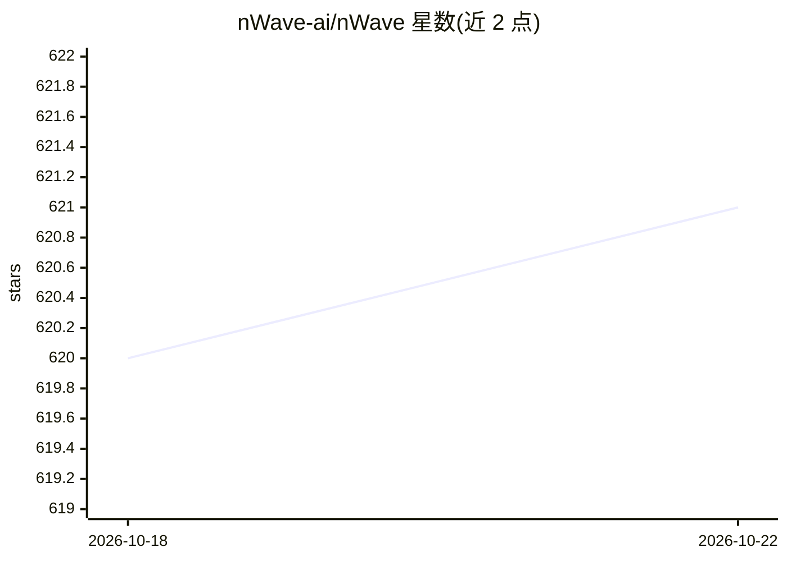

# nWave-ai/nWave

⭐ 622 · Python · MIT · 推送 2026-09-16 · [GitHub](https://github.com/nWave-ai/nWave) · [官网](https://nwave.ai) · 组织维护

**在 Claude Code 内运行的多 agent 分阶段软件开发工作流框架**

nWave 是嵌入 Claude Code 运行的 agentic 开发工作流：将功能交付拆为七个阶段（discover/diverge/discuss/design/devops/distill/deliver），共 40 个专职 agent 在各阶段产出文档与测试工件，每个阶段需人工审查批准后才继续，机器不端到端无人监督运行。提供 3 阶段 TDD 规范（RED→GREEN→COMMIT）、DES 钩子做阶段强制与审计日志、结果注册表在设计期去重、L7 单文件 feature-delta 格式与 lean/full 文档密度控制。通过 curl 一键脚本安装 nwave-ai CLI（依赖 Python 3.10+），支持 uv/pipx/pip、Codex CLI、OpenCode 及离线安装；插件市场安装被明确标注不推荐（DES 强制不生效）。v3.22.1 为当前维护版本，存在 #78 已知限制。

## 筛选速览

| 维度 | 判定 | 备注 |
|---|---|---|
| AI 角色 | `ai-ecosystem` | LLM/agent 周边工具 |
| 许可风险 | `permissive` | MIT |
| 部署形态 | `library` | 以包/库形式分发 |
| 模型依赖 | locked-api |  |
| 硬件要求 | — | 无带数字的原话,不猜 |
| 安装摩擦 | `low` | 无编译、无系统依赖或容器化 |
| 成熟度 | — | 结构信号不足 |

## 能力要点

- 七阶段（wave）交付流程，共 40 个 agent，每阶段人工审查门控
- DES 钩子实现 TDD 阶段强制、审计日志与 rigor profiles
- nwave-ai CLI 提供 install/uninstall/doctor/status 等命令，一键脚本安装
- 支持 Claude Code、Codex CLI、OpenCode 三种宿主及离线/气隙安装

## 适用场景

- 在 Claude Code 中按阶段引导从需求到 TDD 实现的完整功能交付
- 绿地方案前期用 DISCOVER/DIVERGE 阶段做探索与头脑风暴
- 团队按统一工作流与工件结构协作开发
- 在 CI 中用 feature-delta 校验器做结构检查

## 场景标签

`多智能体` `编码 Agent` · 领域:Agent 开发

## 证据(README 行号)

> L5: nWave runs inside Claude Code. It breaks feature delivery into seven waves (discover, diverge, discuss, design, devo
> L91: - **3-Phase TDD Canon (Default)** — New canonical TDD methodology (RED → GREEN → COMMIT) replaces the legacy 5-phas
> L114: Each wave produces artifacts that you review before the next wave begins. The machine never runs unsupervised end-

## 星数曲线

2026-10-18 620 → 2026-10-22 621（+1）

---
*卡片 v1 · prompt 1.4 · 生成 2026-10-21 · 置信度 mid · 依据 README sha `6f8273cc9aca` · [字段定义](../../DATASET.md)*
