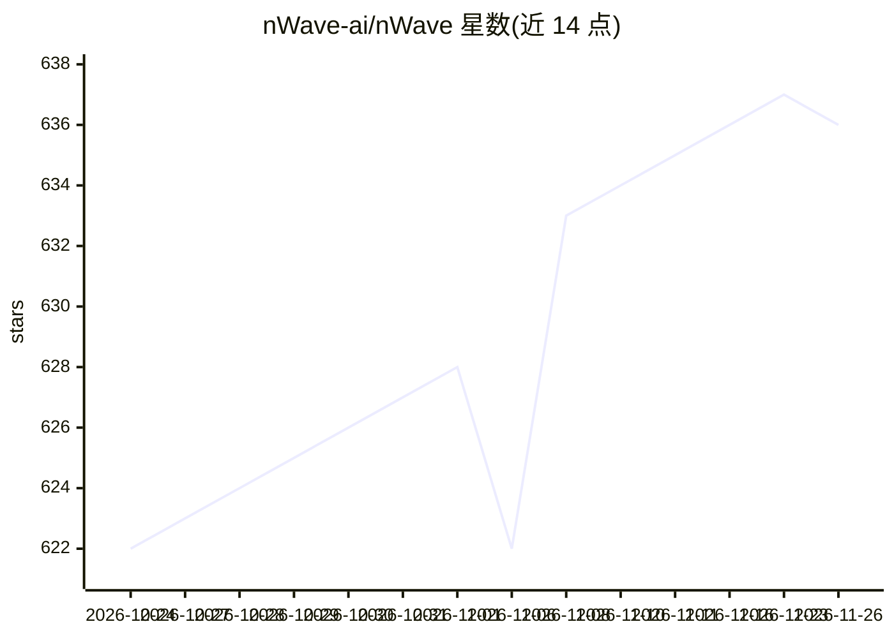

# nWave-ai/nWave

⭐ 636 · Python · MIT · 推送 2026-11-19 · [GitHub](https://github.com/nWave-ai/nWave) · [官网](https://nwave.ai) · 组织维护

**为软件开发团队提供角色化 AI 交付工作流与规范工具**

nWave 为软件团队提供专家角色与由宿主驱动的交付流程：nwdes 命令为每个功能构建唯一 handoff JSON 记录，并从中渲染简报、角色提示词、输出模式与评审包。模型调用由编码宿主（Claude Code、Codex、Cursor、Copilot、Devin 等）完成，nwdes 本身不做模型调用；根助手负责验证，用户决定范围与取舍。交付流程含 RED/GREEN 可执行 oracle、源盲审查、并行 Git worktree lane 等机制。安装需 Python 3.11+、Git 2.38+，仅支持 Linux/macOS/WSL。

## 筛选速览

| 维度 | 判定 | 备注 |
|---|---|---|
| AI 角色 | `ai-ecosystem` | LLM/agent 周边工具 |
| 许可风险 | `permissive` | MIT |
| 部署形态 | `None` |  |
| 模型依赖 | — | README 未给出锁定关系 |
| 硬件要求 | — | 无带数字的原话,不猜 |
| 安装摩擦 | `low` | 无编译、无系统依赖或容器化 |
| 成熟度 | — | 结构信号不足 |

## 能力要点

- nwdes 从单一 handoff JSON 渲染简报、提示词、模式与评审包
- 通过 --platform 安装器部署到 Claude Code、Codex、OpenCode、Cursor、Copilot、OMP、Devin 七种宿主
- 交付流程包含可执行 oracle 独立批准、源盲 EXAMINE 审查
- lane 机制基于 Git worktree 支持单机并行开发

## 适用场景

- 在 Claude Code 等宿主中按角色化流程从想法交付到可用代码
- 团队需要带门禁与独立评审的 ATDD/BDD 开发流程
- 单机多 feature 用 lane 隔离并行推进

## 场景标签

`编码 Agent` `代码审查` · 领域:编码与开发

## 证据(README 行号)

> L3: nWave supplies specialist roles and a host-led delivery workflow for software teams. Its `nwdes` command builds one 
> L100: nwdes builds prompts and packets, records the typed values that roles supply, and refuses what does not add up. It

## 星数曲线

2026-10-24 622 → 2026-11-26 636（+14）

---
*卡片 v1 · prompt 1.4 · 生成 2026-11-24 · 置信度 high · 依据 README sha `552e02ed2d56` · [字段定义](../../DATASET.md)*
