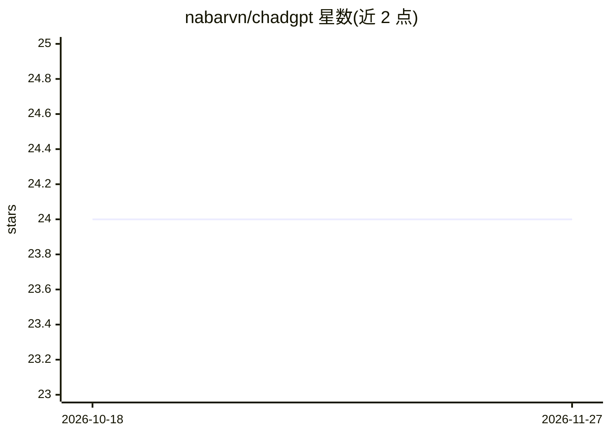

# nabarvn/chadgpt

⭐ 24 · TypeScript · 推送 2026-11-05 · [GitHub](https://github.com/nabarvn/chadgpt) · [官网](https://gpt.nabarun.app) · 个人维护

**全栈网页应用：展示 2023 年 1 月版 ChatGPT 交互体验**

基于 Next.js 的全栈 GPT 网页应用，通过 OpenAI API 流式输出回答，提供自定义 AI 人设（直接、自信的回答风格）。聊天历史通过 Firebase/Firestore 跨设备同步，使用 NextAuth.js 的 Google OAuth 登录，界面支持 Markdown 渲染与代码块语法高亮，Upstash Redis 实现速率限制以防 API 滥用。需要自备 Firebase、Google Cloud、OpenAI、Upstash Redis 账户及 API 密钥方可本地运行。

## 筛选速览

| 维度 | 判定 | 备注 |
|---|---|---|
| AI 角色 | `ai-native` | 本体是模型或模型工具 |
| 许可风险 | `none` | — |
| 部署形态 | `library` | 以包/库形式分发 |
| 模型依赖 | — | README 未给出锁定关系 |
| 硬件要求 | — | 无带数字的原话,不猜 |
| 安装摩擦 | `low` | 无编译、无系统依赖或容器化 |
| 成熟度 | — | 结构信号不足 |

## 能力要点

- 实时流式输出 AI 回答
- 聊天历史经 Firebase 自动同步跨设备
- Google OAuth 登录（NextAuth.js）
- Upstash Redis 速率限制防 API 滥用

## 适用场景

- 本地部署一个带登录和聊天记录同步的 GPT 网页界面
- 为自定义 AI 人设搭建全栈聊天应用
- 学习 Next.js 全栈接入 OpenAI API 流式输出的实现

## 场景标签

`聊天机器人` · 领域:对话与助手

## 证据(README 行号)

> L19: ChadGPT is a full-stack GPT implementation built with Next.js, featuring a custom AI persona that delivers direct, 
> L175: - **Real-time AI Response Streaming** - Watch AI responses appear as they're generated

## 星数曲线

2026-10-18 24 → 2026-11-27 24（+0）

---
*卡片 v1 · prompt 1.4 · 生成 2026-11-18 · 置信度 high · 依据 README sha `c987724cbbf5` · [字段定义](../../DATASET.md)*
