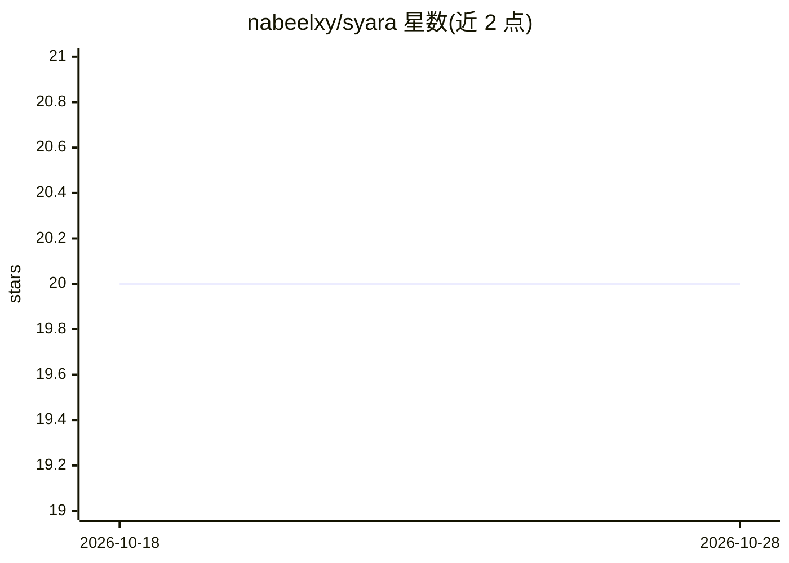

# nabeelxy/syara

⭐ 20 · Python · MIT · 推送 2026-10-12 · [GitHub](https://github.com/nabeelxy/syara) · [官网](https://superyara.org) · 个人维护

**面向安全检测的 YARA 兼容语义规则引擎库**

Python 库，扩展 YARA 规则语法以支持语义匹配：在传统字符串/正则规则之外，提供基于 SBERT 嵌入的相似度规则、ML 分类器规则、LLM 评估规则、Sigma 风格字段匹配、pHash 多媒体规则与结构化决策模型（JEV/Laya/Winnow-E4B），用于检测钓鱼、提示注入、越狱、虚假信息等场景。面向安全分析师与开发者，通过 pip 安装，支持自定义 matcher/classifier/LLM evaluator 与 YAML 配置，执行时按成本从低到高排序并短路跳过高开销规则，同模型决策标识符合并为单次 API 调用，SBERT 嵌入带会话级缓存。

## 筛选速览

| 维度 | 判定 | 备注 |
|---|---|---|
| AI 角色 | `ai-native` | 本体是模型或模型工具 |
| 许可风险 | `permissive` | MIT |
| 部署形态 | `desktop` | 安装包/桌面程序 |
| 模型依赖 | — | README 未给出锁定关系 |
| 硬件要求 | — | 无带数字的原话,不猜 |
| 安装摩擦 | `low` | 无编译、无系统依赖或容器化 |
| 成熟度 | — | 结构信号不足 |

## 能力要点

- YARA 兼容语法下增加相似度/分类器/LLM/字段/决策/pHash 六类规则
- 执行成本自动排序与短路：fields≈strings << similarity < classifier < decision << llm
- 决策模型返回 choice/noul/score 结构化答案，同模型标识符单次 API 调用
- 可扩展 SemanticMatcher/SemanticClassifier/LLMEvaluator/DecisionEvaluator 四类组件

## 适用场景

- 编写规则检测提示注入、越狱尝试与钓鱼文本
- 对日志/告警等结构化事件做 Sigma 风格字段匹配
- 用 pHash 检测仿冒 logo 的图像钓鱼

## 场景标签

`网络安全` `语义搜索` · 领域:知识与检索

## 证据(README 行号)

> L11: SYARA helps to write rules in natural language so that they can match similar intents semantically. It supports rul
> L18: - **Semantic Similarity Matching**: Using SBERT and other embedding models

## 星数曲线

2026-10-18 20 → 2026-10-28 20（+0）

---
*卡片 v1 · prompt 1.4 · 生成 2026-10-28 · 置信度 high · 依据 README sha `4eda9e12df20` · [字段定义](../../DATASET.md)*
