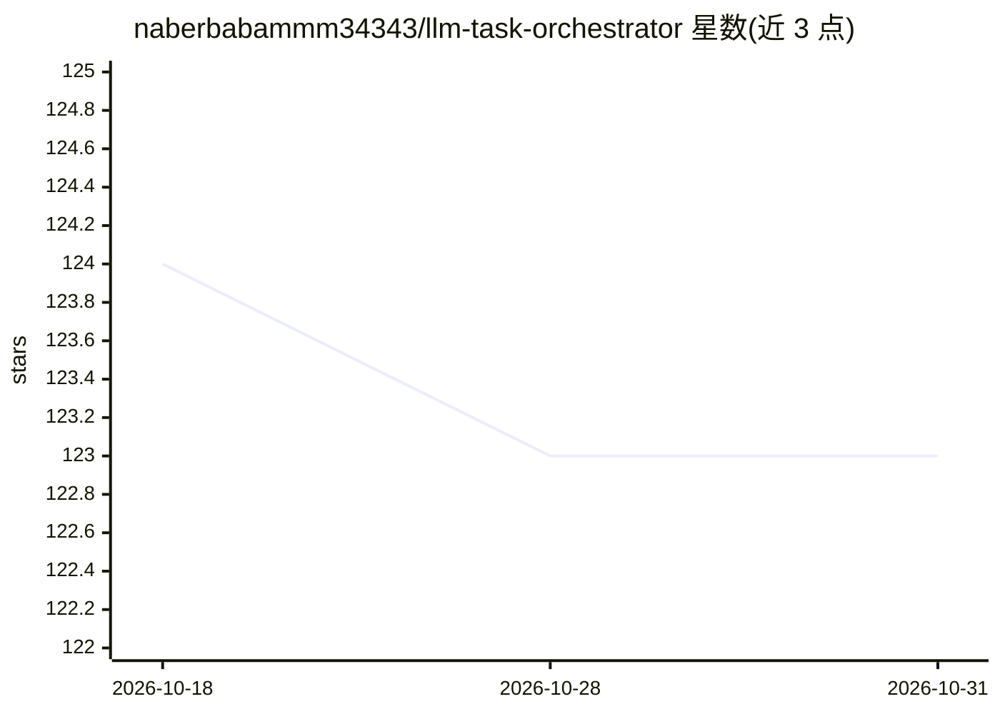

# naberbabammm34343/llm-task-orchestrator

⭐ 123 · HTML · 推送 2026-10-30 · [GitHub](https://github.com/naberbabammm34343/llm-task-orchestrator) · 个人维护

**LLM 请求语义分类与路由编排层：按任务特征选模型并留审计轨迹**

Polyphonic Decision Engine 是面向多模型工作流团队的 LLM 路由编排层：对每个请求按结构复杂度、歧义度、新颖性等维度做多因子语义分类，依据确定性规则将任务路由到匹配的模型端点，并记录从请求到响应的完整审计日志（分类分数、路由决策、响应时间）。支持可配置回退链、YAML 路由配置、请求批处理与优先级队列，可作 API 网关代理、嵌入库或 CLI 使用。声明不捆绑任何模型与凭证，由用户自备模型访问；路线图显示 2026 年各季度功能尚未发布。README 未给出可执行的安装命令，多处仅置 Download 占位。

## 筛选速览

| 维度 | 判定 | 备注 |
|---|---|---|
| AI 角色 | `ai-ecosystem` | LLM/agent 周边工具 |
| 许可风险 | `none` | — |
| 部署形态 | `None` |  |
| 模型依赖 | — | README 未给出锁定关系 |
| 硬件要求 | — | 无带数字的原话,不猜 |
| 安装摩擦 | `low` | 无编译、无系统依赖或容器化 |
| 成熟度 | — | 结构信号不足 |

## 能力要点

- 多因子语义任务分类（复杂度/歧义度/领域/新颖性）
- 确定性路由规则与完整可审计决策日志
- 可配置回退链与失败响应保留
- API 网关 / 库 / CLI 三种集成模式

## 适用场景

- 企业把简单代码任务路由到快模型、架构决策留给深推理模型
- 遗留系统重构时区分机械性与语义性转换分别路由
- 为多模型工作流建立可审计的请求路由与合规日志

## 场景标签

`模型网关` · 领域:Agent 开发

## 证据(README 行号)

> L5: **Polyphonic Decision Engine** is an orchestration layer for large language model routing that transcends simple loa
> L13: Polyphonic Decision Engine approaches this challenge through what we call **semantic routing triage**: each incomin
> L100: - **API Gateway Mode**: Operates as a transparent proxy between services and LLM endpoints

## 星数曲线

2026-10-18 124 → 2026-10-31 123（-1）

---
*卡片 v1 · prompt 1.4 · 生成 2026-10-23 · 置信度 mid · 依据 README sha `3311c316c57a` · [字段定义](../../DATASET.md)*
