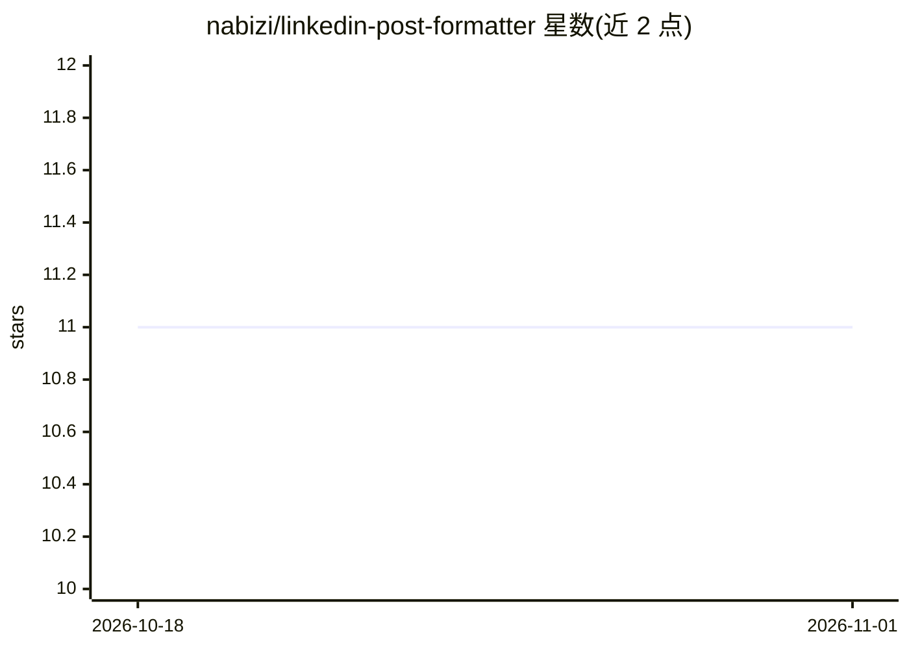

# nabizi/linkedin-post-formatter

⭐ 11 · CSS · MIT · 推送 2026-02-20 · [GitHub](https://github.com/nabizi/linkedin-post-formatter) · [官网](https://ai.blabigo.com) · 组织维护

**LinkedIn 帖文文本格式化工具（浏览器直接打开）**

由慕尼黑初创 Blabigo 发布的免费开源静态网页工具：下载 zip 解压后用浏览器打开 index.html 即可运行，也可部署到 Apache/MAMP/WAMP/LAMP 服务器；提供在线试用版本。功能为 LinkedIn 帖文文本格式化，部分功能基于开源软件 toUnicodeVariant（Unicode 变体转换）。README 大部分篇幅为 Blabigo 品牌与个人品牌建设的介绍，其中 AI 能力（内容起草）属于 Blabigo 主产品而非本工具。

## 筛选速览

| 维度 | 判定 | 备注 |
|---|---|---|
| AI 角色 | `ai-enhanced` | 去掉 AI 部分产品仍成立 |
| 许可风险 | `permissive` | MIT |
| 部署形态 | `None` |  |
| 模型依赖 | — | README 未给出锁定关系 |
| 硬件要求 | — | 无带数字的原话,不猜 |
| 安装摩擦 | `low` | 无编译、无系统依赖或容器化 |
| 成熟度 | — | 结构信号不足 |

## 能力要点

- 零依赖静态网页：解压后浏览器打开 index.html 即可使用
- 部分功能基于开源软件 toUnicodeVariant
- 提供在线试用版与本地服务器部署两种方式

## 适用场景

- 发布前对 LinkedIn 帖文做 Unicode 字体样式格式化
- 本地离线使用，无需注册或安装运行时

## 场景标签

 · 领域:社交媒体工具

## 证据(README 行号)

> L5: Simply download the zip file, unzip it, and open the index.html file in your browser. Alternatively, you can use an 
> L22: We double down on AI to make the process of content ideation and writing as easy as possible, imagine you have a gh

## 星数曲线

2026-10-18 11 → 2026-11-01 11（+0）

---
*卡片 v1 · prompt 1.4 · 生成 2026-11-01 · 置信度 mid · 依据 README sha `14ddd84f79fc` · [字段定义](../../DATASET.md)*
