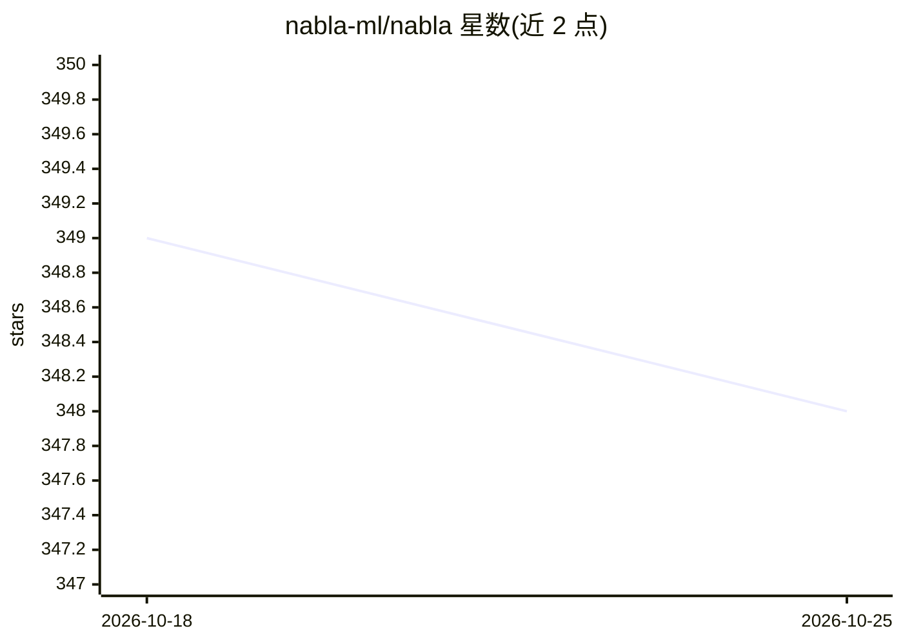

# nabla-ml/nabla

⭐ 348 · Python · Apache-2.0 · 推送 2026-03-06 · [GitHub](https://github.com/nabla-ml/nabla) · [官网](https://www.nablaml.com) · 组织维护

**高性能科学计算与机器学习框架，基于 Mojo & MAX**

Nabla 是结合命令式与函数式 API 的高性能科学计算和机器学习框架，构建在 Mojo 与 Modular MAX 之上。提供基于追踪的自动微分、SPMD 分片分布式执行、GPipe 流水线并行、动态形状编译，并支持将自定义 Mojo 内核嵌入自动微分引擎。支持 Linux AMD/NVIDIA GPU 原生执行，macOS Apple Silicon 需 Xcode Metal 工具链。要求 Python 3.12+ 与 Modular nightly，处于活跃开发阶段（main 分支），Apache 2.0 许可。

## 筛选速览

| 维度 | 判定 | 备注 |
|---|---|---|
| AI 角色 | `ai-ecosystem` | LLM/agent 周边工具 |
| 许可风险 | `permissive` | Apache-2.0 |
| 部署形态 | `library` | 以包/库形式分发 |
| 模型依赖 | — | README 未给出锁定关系 |
| 硬件要求 | — | 无带数字的原话,不猜 |
| 安装摩擦 | `low` | 无编译、无系统依赖或容器化 |
| 成熟度 | `idea` | |

## 能力要点

- 基于追踪的自动微分（trace-based autodiff）
- SPMD 分片与 GPipe 分布式流水线并行
- 自定义 Mojo 内核可嵌入自动微分引擎
- 动态形状编译，符号维度避免重编译

## 适用场景

- 需要自动微分的科学计算工作负载
- 多设备分布式训练的张量分片
- 用 Mojo 编写高性能自定义内核并参与梯度计算

## 场景标签

`模型训练` · 领域:训练与推理

## 证据(README 行号)

> L3: > Nabla is a high-performance scientific computing and machine learning framework combining imperative and functiona
> L7: Development Status

## 星数曲线

2026-10-18 349 → 2026-10-25 348（-1）

---
*卡片 v1 · prompt 1.4 · 生成 2026-10-21 · 置信度 high · 依据 README sha `828091517615` · [字段定义](../../DATASET.md)*
