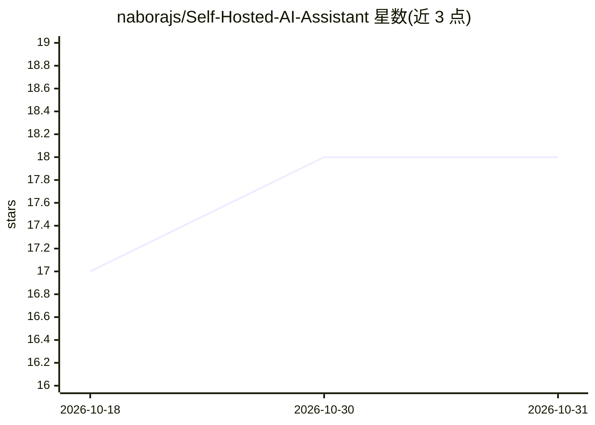

# naborajs/Self-Hosted-AI-Assistant

⭐ 18 · Python · 推送 2026-10-18 · [GitHub](https://github.com/naborajs/Self-Hosted-AI-Assistant) · 个人维护

**自托管的 WhatsApp/Telegram AI 助手平台，本地 Ollama 推理**

隐私优先的本地 AI 助手平台：通过 WhatsApp 伴生设备桥接与 Telegram 网关接入对话，推理由本地 Ollama 提供（零自动拉取模型，需手动在 .env 指定已安装模型）。功能包括长期记忆与相关性检索、沙箱化工具执行（高危操作需 /confirm 令牌人工确认，120 秒有效）、预设回复引擎、知识库导入、人格与系统提示词管理，后端为 FastAPI 加 SQLite WAL 消息队列，提供 edith 终端 CLI 与 Admin/Machine Chat API。

## 筛选速览

| 维度 | 判定 | 备注 |
|---|---|---|
| AI 角色 | `ai-native` | 本体是模型或模型工具 |
| 许可风险 | `none` | — |
| 部署形态 | `library` | 以包/库形式分发 |
| 模型依赖 | local-ok | 支持本地模型 |
| 硬件要求 | — | 无带数字的原话,不猜 |
| 安装摩擦 | `low` | 无编译、无系统依赖或容器化 |
| 成熟度 | — | 结构信号不足 |

## 能力要点

- WhatsApp 桥接与 Telegram 网关双通道接入
- 本地 Ollama 推理，零自动拉取模型策略
- 沙箱化工具执行与 120 秒人工确认令牌机制
- SQLite WAL 持久化消息队列与 edith CLI 管理

## 适用场景

- 在 WhatsApp/Telegram 上运行自己的私有 AI 助手
- 通过 Admin API 与 Machine Chat API 做本地自动化集成
- 导入知识库训练个人助手并管理其记忆与人格

## 场景标签

`AI 助手` `聊天机器人` `Agent 记忆` · 领域:Agent 开发

## 证据(README 行号)

> L13: A privacy-first, local AI assistant platform for WhatsApp, Telegram, and Ollama. Configure behavior, train the mode
> L27: - Machine Chat API (`POST /api/chat`, `POST /v1/chat`) for local developer and automation integrations

## 星数曲线

2026-10-18 17 → 2026-10-31 18（+1）

---
*卡片 v1 · prompt 1.4 · 生成 2026-10-29 · 置信度 mid · 依据 README sha `94f871095779` · [字段定义](../../DATASET.md)*
