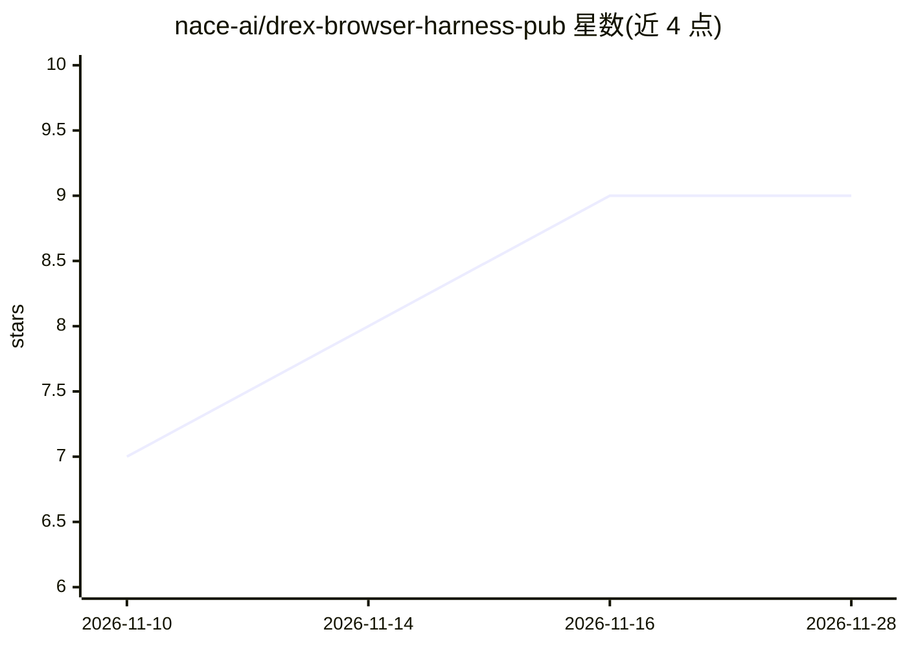

# nace-ai/drex-browser-harness-pub

⭐ 9 · JavaScript · MIT · 推送 2026-11-09 · [GitHub](https://github.com/nace-ai/drex-browser-harness-pub) · [官网](https://console.nace.ai/docs) · 组织维护

**让 AI 在真实浏览器中代你点击输入完成任务**

nace.ai 开发的浏览器自动化 agent：用户用自然语言描述网页任务，Drex Max 决策模型从页面控件与截图中选取每次点击、按键和滚动，LLM 负责任务规划、页面读取与结果校验。提供三种运行方式：本地 runner 以 MCP server 或 CLI 供编码 agent 调用；Chrome 扩展侧栏供个人使用；云端运行尚未提供。runner 与扩展均需从本仓库源码构建，未发布到 npm 或 Chrome 商店。不输入密码或支付信息，识别为高风险的点击（支付、发送、删除等）需人工批准。

## 筛选速览

| 维度 | 判定 | 备注 |
|---|---|---|
| AI 角色 | `ai-native` | 本体是模型或模型工具 |
| 许可风险 | `permissive` | MIT |
| 部署形态 | `None` |  |
| 模型依赖 | locked-api |  |
| 硬件要求 | — | 无带数字的原话,不猜 |
| 安装摩擦 | `low` | 无编译、无系统依赖或容器化 |
| 成熟度 | — | 结构信号不足 |

## 能力要点

- Drex Max 小模型执行动作 + 可选 LLM 规划校验的双层架构
- MCP server 与 CLI 双接入，供 Claude Code/Codex/Cursor 等编码 agent 调用
- Chrome 扩展侧栏带风险点击批准卡片
- Loop 模式单 LLM 会话贯穿全任务，附 WebArena-Verified 与 MiniWoB++ 基准数据

## 适用场景

- 让编码 agent 通过 MCP 调用浏览器完成信息查找
- 自动填写注册表单并返回确认信息
- 在电商页面查找指定商品并返回名称与价格

## 场景标签

`浏览器自动化` · 领域:效率与自动化

## 证据(README 行号)

> L3: Drex Browser Use by nace.ai. Describe a browser task in plain words: Drex Max takes the actions, for a fraction of a
> L33: |**Local runner** (`nace-browser`)|Coding agents on your machine: Claude Code, Codex, Cursor, Hermes, Pi and any ag
> L119: or clicks a point or drags itself on a canvas or a shape, or answers. Drex Max makes the moves on the page's contr

## 星数曲线

2026-11-10 7 → 2026-11-28 9（+2）

---
*卡片 v1 · prompt 1.4 · 生成 2026-11-20 · 置信度 high · 依据 README sha `895be67ca0a4` · [字段定义](../../DATASET.md)*
