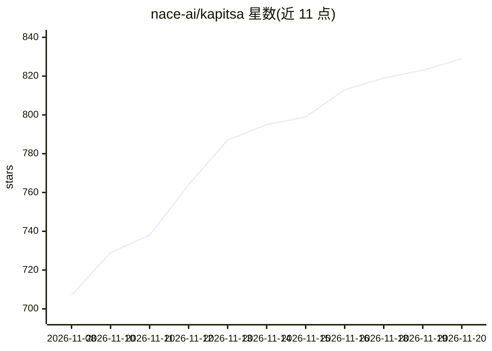

# nace-ai/kapitsa

⭐ 829 · C++ · Apache-2.0 · 推送 2026-11-19 · [GitHub](https://github.com/nace-ai/kapitsa) · [官网](https://kapitsa.vercel.app) · 组织维护

**Apple Silicon 本地推理引擎：为编程 agent 运行 Qwen/Nemotron 等模型**

面向 Mac（M1 及以上、macOS 14+）的本地 LLM 推理引擎，运行 Qwen、Nemotron、Recursive Flint、Clover 及 Drex 决策模型，并通过 KFlash（草稿模型猜测候选 token 的树状验证）做投机解码。可一键启动 Claude Code、Codex、opencode、aider、Goose 等编程 agent 使用本地模型，并在 127.0.0.1:8000 提供 OpenAI 与 Anthropic 兼容 API 及聊天页。支持多台 Mac 分摊模型、SSD 流式加载专家、C ABI 进程内 SDK 与 Node.js 绑定。限制：仅 Apple Silicon，无 Linux/Windows；部分模型只读文本。通过 brew 或安装脚本安装。

## 筛选速览

| 维度 | 判定 | 备注 |
|---|---|---|
| AI 角色 | `ai-ecosystem` | LLM/agent 周边工具 |
| 许可风险 | `permissive` | Apache-2.0 |
| 部署形态 | `None` |  |
| 模型依赖 | local-ok | 支持本地模型 |
| 硬件要求 | — | 无带数字的原话,不猜 |
| 安装摩擦 | `low` | 无编译、无系统依赖或容器化 |
| 成熟度 | — | 结构信号不足 |

## 能力要点

- KFlash 投机解码：best-first 树验证草稿模型候选
- 一条命令在本地模型上启动 Claude Code/Codex/opencode 等 8 种编程 agent
- 提供 OpenAI 与 Anthropic 兼容 API（127.0.0.1:8000）
- 小内存 Mac 跑大模型：48GB 跑 180B（专家从 SSD 流式加载），多 Mac 分摊

## 适用场景

- 让 Claude Code、Codex 等编程 agent 用本地模型工作
- 在 Mac 上本地部署 Qwen/Nemotron 并以 OpenAI/Anthropic API 供其他工具调用
- 内存受限的 Mac 上运行大参数量模型

## 场景标签

`推理引擎` · 领域:训练与推理

## 证据(README 行号)

> L3: Kapitsa is an inference engine for Apple silicon that runs Qwen, Nemotron and Recursive's Flint models locally, buil
> L39: - 🔌 **OpenAI and Anthropic APIs**: plus a chat page, on `127.0.0.1:8000`
> L106: kapitsa serve                   # chat + OpenAI/Anthropic APIs at http://127.0.0.1:8000

## 星数曲线

2026-11-08 707 → 2026-11-20 829（+122）

---
*卡片 v1 · prompt 1.4 · 生成 2026-11-17 · 置信度 high · 依据 README sha `ec33d3fa0f6c` · [字段定义](../../DATASET.md)*
